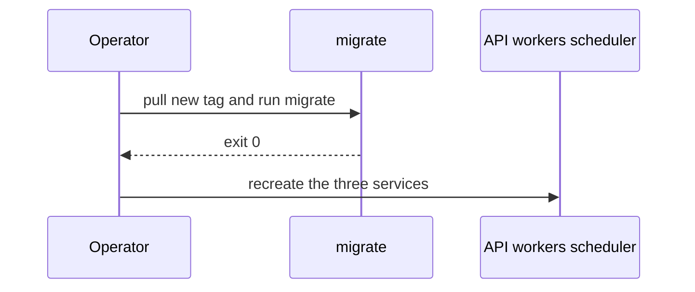

Day-to-day operations for the engine you started in [Deploy the engine](/deployment-guide/engine/). Commands assume the directory that holds `compose.yml`. Add `-f compose.chap.yml` when you used the CHAP overlay.

## Before you start

The stack is up: `migrate` has exited 0, and `api`, the workers, and one `scheduler` are running.

## Logs

```bash
docker compose -f compose.yml logs -f api
docker compose -f compose.yml logs -f worker-1 scheduler
```

`api`, `worker`, and `scheduler` are distroless. `docker exec` into them fails because there is no shell. Use `docker logs` or `docker compose logs`.

## Scheduler and workers

Never scale `scheduler`. A second replica double-fires pipelines. Workers are stateless and may be scaled. The Compose file starts two, `worker-1` and `worker-2`.

## Upgrade

Pin the new tag in `.env`, pull it, run migrate to completion, then recreate the API, both workers, and the single scheduler.



```bash
docker compose -f compose.yml pull
docker compose -f compose.yml run --rm migrate
docker compose -f compose.yml up -d api worker-1 worker-2 scheduler
```

`migrate` must exit 0 before you recreate the other services. Do not add a second scheduler while the old one is still running.

## Back up

Back up the Postgres volume `postgres_data`. Compose prefixes the Docker volume with the project name (usually the directory name). `rabbitmq_data` only holds in-flight messages. `caps_outputs` holds worker files under `/tmp/caps-outputs`.

## Secrets

Rotate `POSTGRES_PASSWORD`, `RABBITMQ_PASSWORD`, `DHIS2_PASSWORD`, and `CHAP_API_TOKEN` in `.env`, and keep each password identical to the URL that contains it. Recreate the services that read those variables. Do not commit `.env`.

`OTEL_EXPORTER_OTLP_ENDPOINT` is optional. Leave it empty to disable tracing.

## Clock

Schedule expressions are 5-field cron (minute, hour, day, month, weekday). The scheduler evaluates them in the timezone of the host running that process. A tick that was missed while the scheduler was down is not replayed. A tick that is still running is not overlapped.

## Check

`docker compose ps` still shows one scheduler, and `migrate` from the upgrade command exited 0.

## If this fails

Two schedulers, or a restart loop after a bad `DATABASE_URL`, are in [Troubleshooting](/deployment-guide/troubleshooting/).
