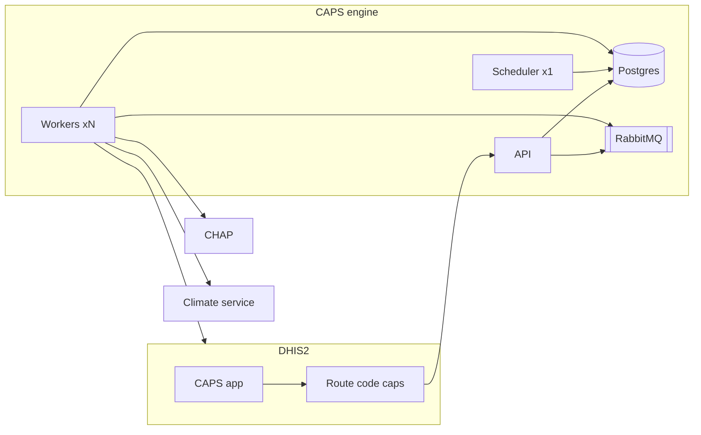

This guide is for a DHIS2 implementer or server administrator who can run Docker, edit an environment file, and install a DHIS2 app. It installs CAPS and hands the system over. Creating a pipeline, scheduling it, and reading an execution are in the [User Guide](/user-guide/). Changing the engine or the app is in the [Development Guide](/development-guide/).

CAPS is two installable pieces:

- **Engine images** on `ghcr.io/hisptz/caps-engine/`: an API, workers, one scheduler, and a one-shot migration job. They use Postgres and RabbitMQ, and the workers call CHAP, a climate service, and DHIS2.
- **The CAPS app**, a DHIS2 app zip, on DHIS2 2.41 or newer.

The browser talks only to DHIS2. The Route is called by the DHIS2 server. Workers call CHAP, the climate service, and DHIS2. Run exactly one scheduler.

## You are finished when

1. Postgres, RabbitMQ, the migrate job, the API, at least one worker, and exactly one scheduler are running.
2. The API can be reached at the URL the DHIS2 server will call.
3. The CAPS app is installed on DHIS2 2.41 or newer.
4. A DHIS2 Route with code `caps` points at that API, and **Settings** shows **Connected**.
5. Workers can reach DHIS2, CHAP, and the climate service with the URLs configured for them.

## Next

1. [Deploy the engine](/deployment-guide/engine/).
2. [Deploy the app](/deployment-guide/app/), then [connect it](/deployment-guide/app/route/).
3. [Check the install](/deployment-guide/check/).
