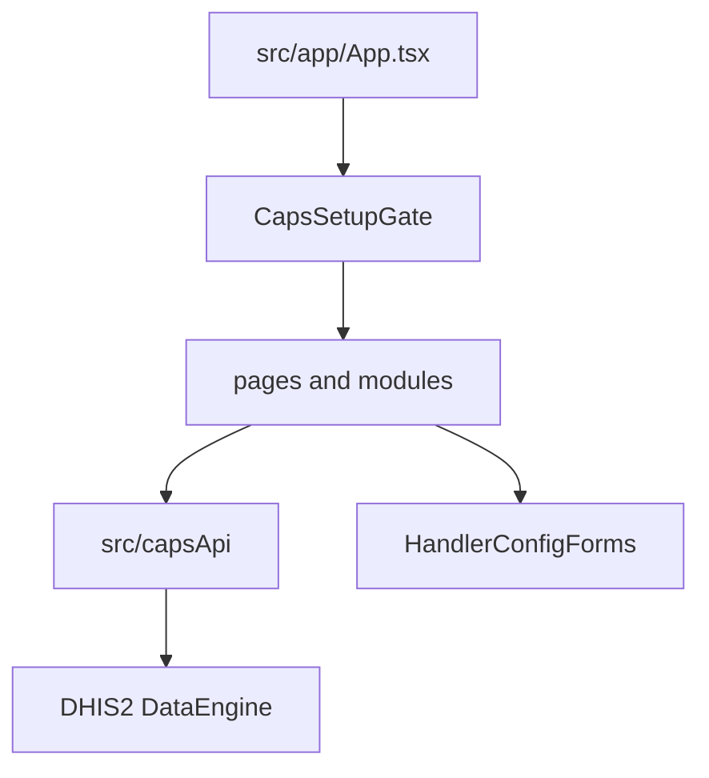

This page is how caps-app source is arranged. Starting the dev server is [Run the app](/development-guide/app/).

## Before you start

The repository is cloned.

## The shell

DHIS2 hosts the app. The browser does not call the engine origin. `src/app/App.tsx` mounts the query client, `CapsSetupGate`, and `HashRouter`. A missing Route with code `caps` renders **Welcome to CAPS**. After that, each screen is a hash route.

A screen in `src/pages/` or `src/modules/` reads and writes CAPS only through `src/capsApi/`, which uses the DHIS2 data engine against `routes/caps/run`. The same app reads DHIS2 metadata (organisation units, data elements, the Route) through `@dhis2/app-runtime` directly. Handler fields live in `src/shared/components/HandlerConfigForms/` and must use the engine enum string. That contract is [Pipeline steps](/development-guide/handlers/), not this page.

`capsApi` is the only path to the engine. Metadata reads go through `@dhis2/app-runtime` and are not on that arrow.

| Path | What to edit |
| --- | --- |
| `src/app/App.tsx` | Shell, `CapsSetupGate`, `HashRouter` |
| `src/capsApi/` | HTTP via the DHIS2 data engine |
| `src/pages/` and `src/modules/` | Screens |
| `src/shared/components/HandlerConfigForms/` | Operator fields for a handler |
| `d2.config.js` | App title **CAPS**, `minDHIS2Version` 2.41, entry `src/app/App.tsx` |

The menu labels are **Dashboard**, **Pipelines**, **Executions**, **Climate data**, **Settings**, and **About**. Hash routes also exist for analytics and dead letters. They are not in the menu. Do not add them to the menu from this page unless you are changing `AppMenu`.

## Check

You can name the file for the screen or the form you came to change.

## Where this lives

A new handler form is [Pipeline steps](/development-guide/handlers/). The key has to match the engine enum. Tests are [App tests](/development-guide/app/testing/).
