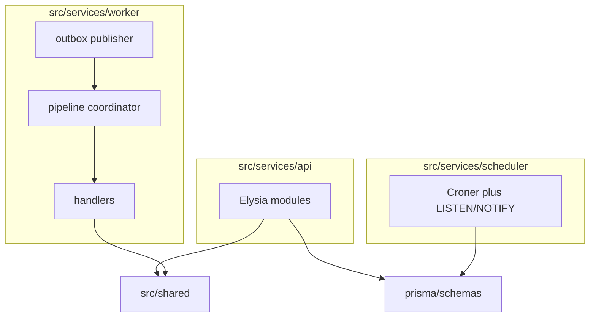

This page is how caps-engine source is arranged. Installing it is [Run the engine](/development-guide/engine/).

## Before you start

The repository is cloned. The processes do not have to be running.

## Three processes

One database, one broker, three entry points.

| Process | Entry | What the source does |
| --- | --- | --- |
| API | `src/services/api/index.ts` | Elysia modules. Writes Postgres. Does not publish to RabbitMQ itself |
| Worker | `src/services/worker/worker.ts` | Outbox publisher, pipeline coordinator, step workers, handlers |
| Scheduler | `src/services/scheduler/index.ts` | Croner jobs. Syncs from Postgres `LISTEN/NOTIFY`. Exactly one process |

A trigger, manual or cron, writes a `PipelineExecution` and an outbox row. `services/outbox/publisher.ts` publishes that row. `services/runners/pipeline.ts` walks steps. A queued step goes to a `step.<handler-key>` queue and `services/workers/step.ts`. The handler class lives under `services/handlers/`. Queue names are declared from the `HANDLERS` map in `services/monitor/topology.ts`. Shared Zod for the API catalog is `src/shared/handlers/catalog.ts`. Models are split under `prisma/schemas/`. The generated client is `prisma/generated/prisma/`.

| Path | What to edit |
| --- | --- |
| `src/services/api/modules/` | Elysia modules (pipelines, schedules, monitoring, handlers, climate, evaluations, system, source routes) |
| `src/services/worker/services/runners/pipeline.ts` | Coordinator |
| `src/services/worker/services/workers/step.ts` | Queued step worker |
| `src/services/worker/services/outbox/publisher.ts` | Outbox publisher |
| `src/services/worker/constants/handlers.ts` | `Handlers` enum and `HANDLERS` map |
| `src/services/worker/services/handlers/` | Step implementations |
| `src/services/worker/services/monitor/topology.ts` | Queue and exchange declarations |
| `src/services/scheduler/` | Croner jobs and Postgres `LISTEN/NOTIFY` |
| `prisma/schemas/` | Models. Client output is `prisma/generated/prisma/` |
| `src/shared/schemas/env.ts` | Validated environment |
| `src/shared/handlers/catalog.ts` | Zod schemas exposed as JSON Schema |

## Rules that outlive a single edit

- Exactly one scheduler process. Workers scale.
- `api`, `worker`, and `scheduler` images are distroless and have no shell.
- Cron is 5-field and uses the host timezone. Missed ticks are not replayed.
- Handler keys are stored on pipelines. Renaming one is a breaking change. The contract with the app is [Pipeline steps](/development-guide/handlers/).

## Check

You can name the file you would edit for the change you have in mind.

## Where this lives

The table above is the index. Tests that cover it are [Engine tests](/development-guide/engine/testing/).
