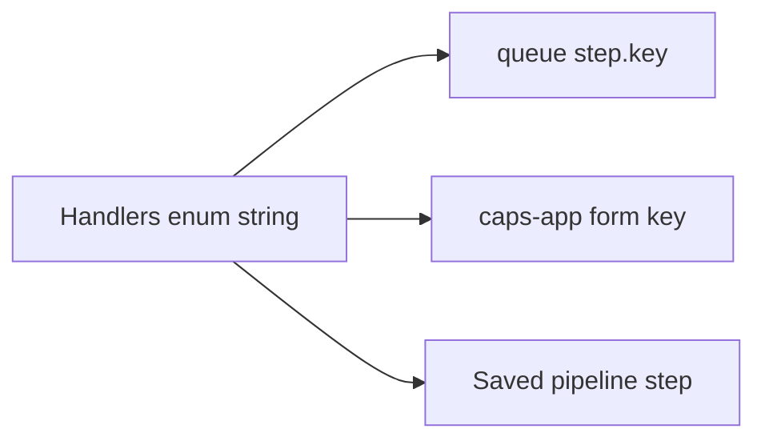

A pipeline step is a handler key shared by caps-engine and caps-app. What the step means to an operator is the [User Guide](/user-guide/). This page is the code contract.

## Before you start

You have read [engine source](/development-guide/engine/architecture/) and [app source](/development-guide/app/architecture/), and [engine tests](/development-guide/engine/testing/) run.

## Steps

Follow `CONVENTIONS.md` in caps-engine.

1. Add a `Handlers` enum string and a `HANDLERS` entry in `src/services/worker/constants/handlers.ts`. The enum member is camelCase and matches the folder name. The enum value is the stable key stored on pipelines. `queueName` is `step.` plus that value.
2. Implement `StepHandler.execute(ctx)` under `src/services/worker/services/handlers/<camelCase>/`.
3. Put operator config on `schemas.config` and pipeline-context reads on `schemas.context`. Leave `schemas: {}` when the step has neither. Do not add dummy objects.
4. Re-export the class from `src/services/worker/services/handlers/index.ts`. Topology picks up queues from the map. Do not invent a queue that is not in the map.
5. In caps-app, add a form under `src/shared/components/HandlerConfigForms/` whose key matches the enum string.



Renaming the string breaks pipelines already stored in Postgres. The app form key and the queue name are the same string.

```typescript title="src/services/worker/constants/handlers.ts"
// Handlers.EXAMPLE_STEP = "example-step"
// queueName: "step.example-step"
// schemas.config / schemas.context, or schemas: {}
```

```typescript title="src/services/worker/services/handlers/exampleStep/index.ts"
export class ExampleStepHandler implements StepHandler {
  async execute(ctx: StepContext): Promise<unknown> {
    return ctx;
  }
}
```

```text title="caps-app"
form key: example-step
folder: src/shared/components/HandlerConfigForms/
```

`execute` lives on `StepHandler` in `src/services/worker/types/service.ts`. The catalog in `src/shared/handlers/catalog.ts` turns the Zod objects into JSON Schema for the app.

## Keys

Re-read `src/services/worker/constants/handlers.ts` before you treat this list as complete.

| Key | Role |
| --- | --- |
| `open-climate-service-sync` | Refresh Open Climate Service datasets |
| `climate-openeo-create` | Start a climate job |
| `climate-openeo-poll` | Poll that job |
| `climate-openeo-download` | Download the result |
| `prediction-trigger` | Start a CHAP prediction |
| `prediction-poll` | Poll CHAP |
| `prediction-data-download` | Download prediction output |
| `dhis2-instance-pull` | Pull from a connected DHIS2 source |
| `dhis2-data-upload` | Write aggregate data back |
| `dhis2-analytics-run` | Run DHIS2 analytics |
| `threshold-generation` | Build thresholds |
| `alert-generation` | Build alerts |
| `event-data-upload` | Write tracker events |

## Check

The handler catalog shows the new key, the app form renders it, and a unit test calls `execute`.

## If this fails

A form that posts a different string than the enum value never reaches the handler. The queue name and the form key are not two names that happen to look alike.
