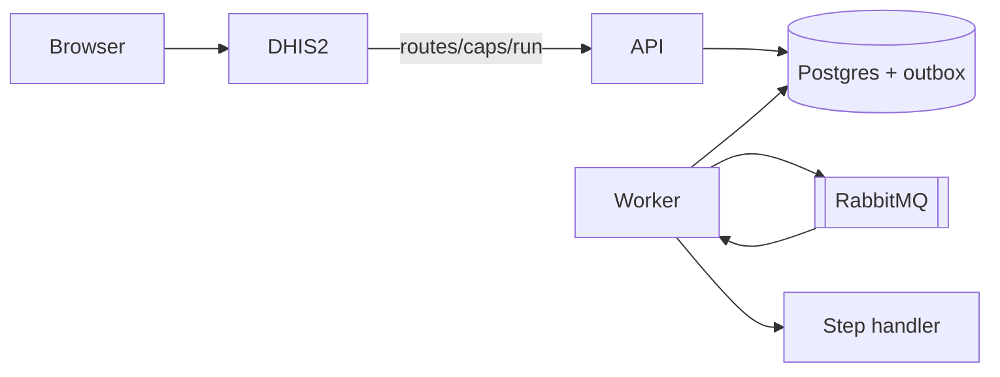

This guide is for someone who will change caps-engine, caps-app, or both. You can use a terminal, Git, and Docker. Installing CAPS for a server is the [Deployment Guide](/deployment-guide/). Running pipelines day to day is the [User Guide](/user-guide/).

A change lands in one of three repositories:

| Change | Repository | Tooling |
| --- | --- | --- |
| HTTP API, worker, scheduler, Prisma, handlers, queues | [hisptz/caps-engine](https://github.com/hisptz/caps-engine) | Bun, Vitest, Docker Compose |
| DHIS2 screens, Route setup, forms that edit handler config | [hisptz/caps-app](https://github.com/hisptz/caps-app) | pnpm, DHIS2 App Platform, Jest, Playwright |
| This documentation site | [hisptz/caps-doc](https://github.com/hisptz/caps-doc) | pnpm, Astro Starlight |

The diagram answers which product to open. [Engine source](/development-guide/engine/architecture/) and [app source](/development-guide/app/architecture/) answer which folder. A new pipeline step usually touches both: a handler in the engine, and a form in the app whose key matches the `Handlers` enum string. That contract is [Pipeline steps](/development-guide/handlers/).

You are ready to change CAPS when:

1. Postgres and RabbitMQ are up, and the engine API, worker, and scheduler reload on the host with `bun run dev:*`.
2. The DHIS2 app runs at `http://localhost:3000` and can reach an engine through a Route with code `caps`.
3. You know which repository owns the change.
4. You can run the same checks CI runs for that repository.

## Next

1. [Run the engine](/development-guide/engine/).
2. [Run the app](/development-guide/app/).
3. After both, [Pipeline steps](/development-guide/handlers/) and [Pull requests](/development-guide/contribute/).
