An execution is one run of a pipeline. Every run is recorded, whether you triggered it, something called the API, or a schedule fired. Each execution keeps its own status, its step-by-step record, and its logs.

## Before you start

You can open [CAPS](/user-guide/interface/). A run exists after you [trigger a pipeline](/user-guide/pipelines/manage/) or a [schedule](/user-guide/schedules/) fires.

## Where to look

**On the pipeline.** Open the pipeline and select **Executions**. This lists only that pipeline's runs. Use it to check one pipeline, or to see whether its schedule is firing.

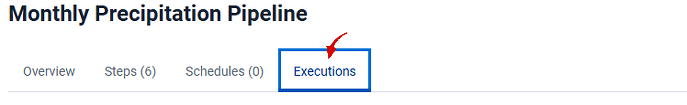

**Across the installation.** Click **Executions** in the left navigation. Each row names its pipeline. Use this for a daily check, or when something failed and you do not yet know which pipeline.

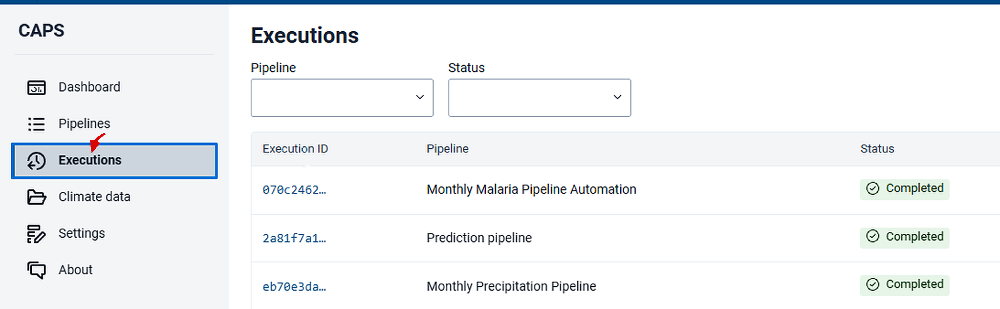

**On Overview.** A pipeline's **Overview** tab has **Total executions**. That field is a count, not a list. A dash means the pipeline has never run. Overview is also where the concurrency policy is shown. That policy is the execution behaviour you chose when you created the pipeline.

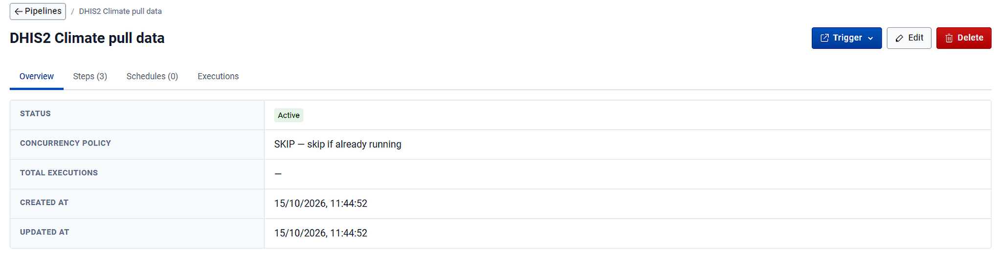

## When a pipeline has never run

The pipeline's **Executions** tab shows *No executions. This pipeline has not been executed yet.*

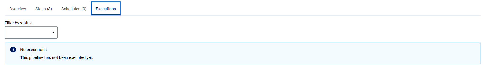

That is expected for a pipeline you just built. If the pipeline has an active schedule and this panel is still there, the schedule has not fired. Check [Schedules](/user-guide/schedules/).

## Columns

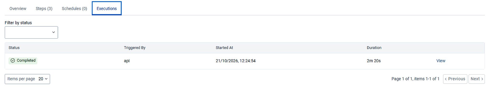

| Column | What it shows |
| --- | --- |
| Status | How the run ended, or where it has reached |
| Triggered By | *api* for a run started by hand or through the API. *scheduler* for a run started by a schedule. |
| Started At | When the run began |
| Duration | How long it took, or how long it has taken so far. A run much longer than usual points at a slow external service. |
| View | Opens the execution |

In the **Executions** section the first column is **Execution ID**, and that identifier is the link. **View** at the end of a row on the pipeline tab opens the same page.

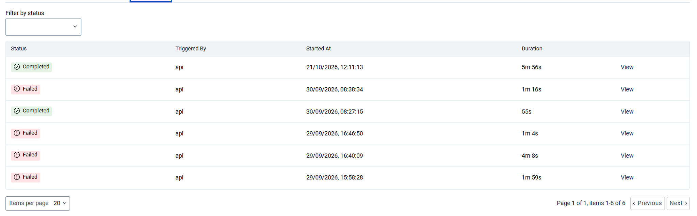

Runs are listed newest first, so the top row is the latest attempt. Several failures followed by a success is the usual shape of a pipeline being corrected: the failures are earlier attempts, and the completed run at the top is the current state. The shape to investigate is the reverse, where recent runs fail after a period of success. Something outside the pipeline has changed.

## Status

| Status | Meaning |
| --- | --- |
| Pending | The run has been created and is waiting to begin |
| Running | Steps are being carried out |
| Awaiting Step | The run is waiting on a step that handed work to another service, such as a prediction or an analytics run |
| Completed | Every step finished successfully |
| Failed | A step did not succeed after its retries were exhausted |
| Cancelled | Someone stopped the run before it finished |
| Paused | The run is held at its current step until it is resumed |

Completed, Failed, and Cancelled are final. The others describe a run still in progress.

## Filter and page

A pipeline's **Executions** tab has one filter, by status. The **Executions** section has two, and they combine: status, and pipeline.

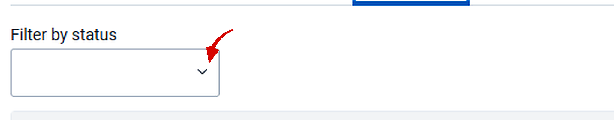

**Filter by status** lists every status, with **All statuses** at the top.

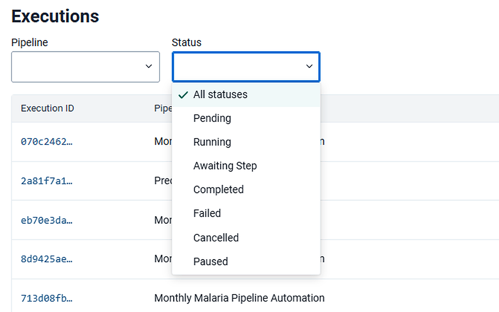

The seven values are Pending, Running, Awaiting Step, Completed, Failed, Cancelled, and Paused, in the order a run passes through them. **Failed** is the short list of what needs attention. **Running** and **Awaiting Step** together show what is in progress, which is worth checking before you trigger a pipeline that uses Skip or Replace.

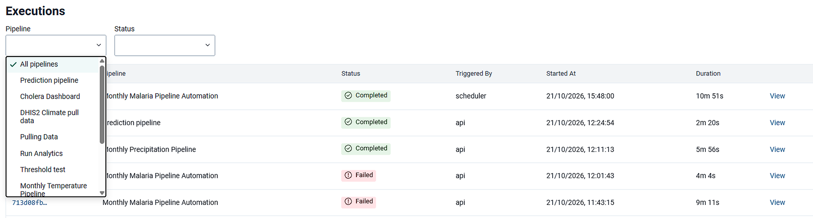

**Filter by pipeline** is only on the **Executions** section, to the left of the status filter. It lists every pipeline, with **All pipelines** ticked by default. Selecting one pipeline and **Failed** is the same view as that pipeline's own **Executions** tab filtered to Failed.

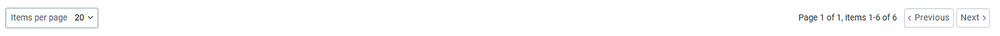

**Items per page** sets how many rows are shown. The counter states the range and the total, for example *Page 1 of 1, items 1-6 of 6*. **Previous** and **Next** move between pages.

## Check

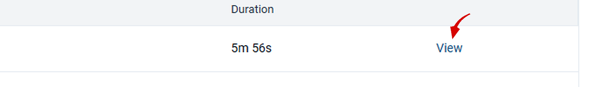

You can open the newest run from **View** or from its **Execution ID**. The next page is [One execution](/user-guide/executions/one-run/).

## Next

If the status is **Failed**, follow [Trace a failure](/user-guide/executions/failures/).
