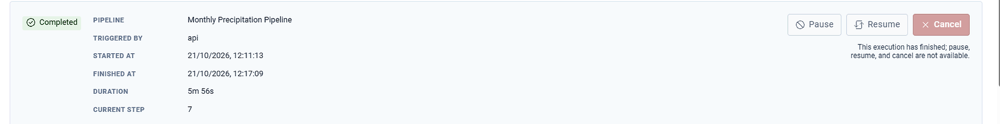
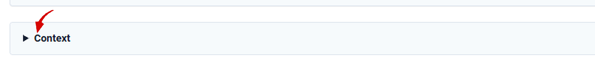
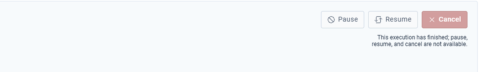
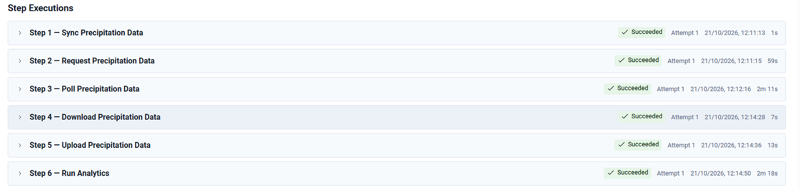
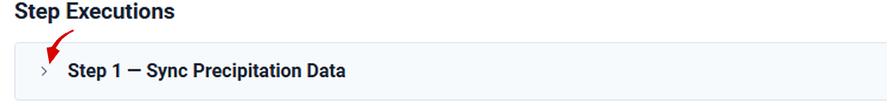
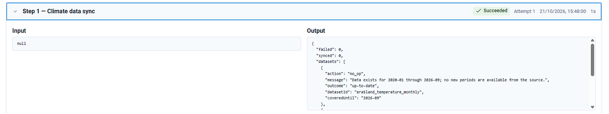
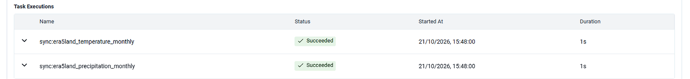
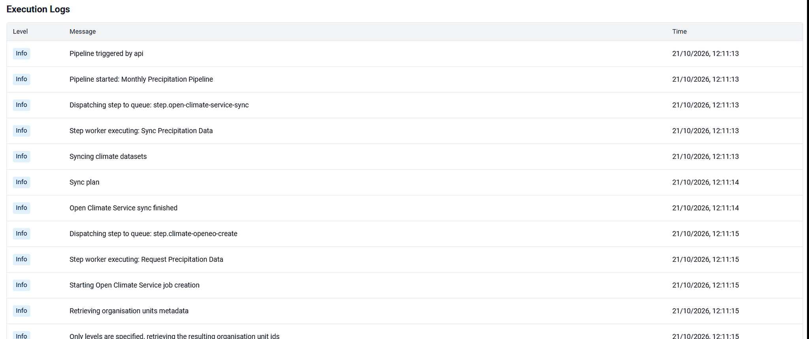

An execution opens on its own page, headed by its identifier. The page has a summary, a **Context** block, **Step Executions**, and **Execution Logs**.

## Before you start

You opened the run from [Read executions](/user-guide/executions/).

## Summary



| Field | What it shows |
| --- | --- |
| Status | The same status as in the list |
| Pipeline | Which pipeline this run belongs to |
| Triggered By | *api* for a run started by hand or through the API. *scheduler* for a run started by a schedule. |
| Started At | When the run began |
| Finished At | When it ended. Absent while the run is still going. |
| Duration | The time between the two |
| Current Step | The step the run has reached |

## Context



**Context** is collapsed until you open it. It is the record of what the run was given and what each step produced, as JSON.

### What the schedule supplied

A run started by a schedule includes the schedule's own details: `scheduleId`, `scheduledAt`, and `scheduleName`. The name matters when the pipeline has more than one schedule. `scheduledAt` is in UTC.

### The overrides that applied

The `steps` object lists every step that received an input context override, keyed by the step's identifier. Read it against [Input context](/user-guide/schedules/input-context/) to confirm what the run used.

A data step records the period and the organisation units it ran against, for example a monthly period `202608` and organisation unit level `3`. A prediction step records its settings as an offset and a count:

```json
{ "period": { "periodOffset": 1, "numberOfPeriodsToGenerate": 3 } }
```

When a run covered the wrong months, the period recorded here is the evidence.

### What each step produced

Each step's output is kept as `step_N_output`.

| Entry | What it reports |
| --- | --- |
| A sync step | Counts of synced, failed, and up-to-date datasets, with a message per dataset |
| An Open Climate Service create step | The job identifier and the temporal extent requested |
| A poll step | The job identifier and its finishing status |
| A download step | The number of values retrieved and the filename they were written to |
| An upload step | The DHIS2 import summary: imported, updated, ignored, and deleted |
| A prediction step | The job identifier, the prediction setup used, and the result |

The upload summary is the check that data arrived. A line such as `"imported": 378, "updated": 875, "ignored": 1, "deleted": 424` shows values being written and existing values replaced. A step reporting zero for every figure succeeded without writing anything.

A polling step records its attempts. `"attempts": 20` means the step checked twenty times before the external job finished. Use that when you decide whether max attempts on the step is high enough.

### Numbering

Context keys outputs from zero, so `step_0_output` is the first step of the pipeline. That matches the Order column on the pipeline's **Steps** tab. **Step Executions** on this page numbers the same step as Step 1.

## Pause, resume, and cancel



Three controls sit at the top right of the summary.

| Control | What it does | Available when |
| --- | --- | --- |
| Pause | Holds the run at its current step. No further steps are queued until you resume. | The run is Running or Awaiting Step |
| Resume | Returns a paused run to Running and continues from the step where it was held. Steps already completed are not repeated. | The run is Paused |
| Cancel | Stops the run and sets its status to Cancelled. | The run has not reached a final status |

All three are unavailable on a finished run. The line under them says: *This execution has finished; pause, resume, and cancel are not available.* A Completed, Failed, or Cancelled run cannot be acted on. To try a failed run again, [trigger the pipeline](/user-guide/pipelines/manage/).

Cancel stops the run going forward. It does not reverse steps that already finished. Data written to DHIS2 before the cancellation stays there. When that matters, run the pipeline again with an import strategy of Merge so the affected values are overwritten.

Pause is the control to use when something outside CAPS needs attention, such as a credential to renew or a service to come back, because the run can continue once that is cleared.

## Step executions



**Step Executions** lists every step in the order it was carried out. Each row shows the step number and name, a status, the attempt number, and the time the step started with its duration.

Steps here are numbered from 1. On the pipeline's **Steps** tab the Order column begins at 0. Order 0 there is Step 1 here.

**Attempt** is the field to watch. *Attempt 1* means the step succeeded the first time. A higher number means the step failed and was retried. The run may still complete, and something at that step is slow or unreliable. A step that regularly reaches Attempt 2 or 3 is worth investigating before it starts failing outright.

The durations show where the time went. Polling and analytics usually dominate, because those steps wait on another service. Steps that move data are comparatively quick.



Click the chevron, or the row, to expand a step.



**Input** shows what the step received. A step that takes nothing from the step before it shows *null*, which is normal for the first step.

### Task executions



Some steps do several pieces of work. Those appear under the step as **Task Executions**, each with its own name, status, start time, and duration. A synchronisation step covering two climate datasets shows one task per dataset, named after it, for example `sync:era5land_temperature_monthly` and `sync:era5land_precipitation_monthly`.

Use the task list when a step fails on one dataset and succeeds on the others. The step has a single status. The task list is where the dataset is named.

## Execution logs



**Execution Logs** is the running account of the run, in the order it happened.

| Column | What it shows |
| --- | --- |
| Level | Info for ordinary progress. Warning and error for anything that went wrong. |
| Message | What happened |
| Time | When it happened, to the second |

Step Executions gives the outcome of each step. The logs give the sequence inside it: the step is dispatched to its queue, a worker picks it up, the work is described as it proceeds, and the step reports finishing. Queue names in the log match the Queue column on the pipeline's **Steps** tab, which is how a log line ties back to a step.

On a failed run, the step list says that a step failed. The logs say what the service said when it did. Follow [Trace a failure](/user-guide/executions/failures/).

## Check

You can name the status, the current step, whether a schedule override was applied, and which step took the most time.

## Next

For a failed run, [trace the failure](/user-guide/executions/failures/). For the values that were written, open the [sectioned dataset](/user-guide/prepare/data/) in Data Entry.
