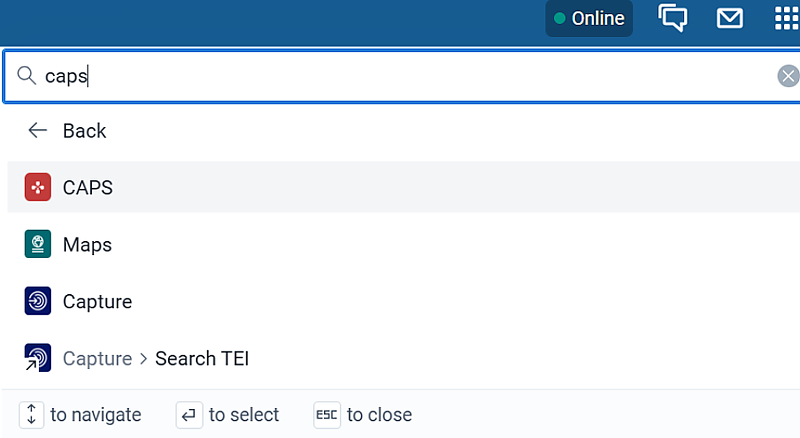
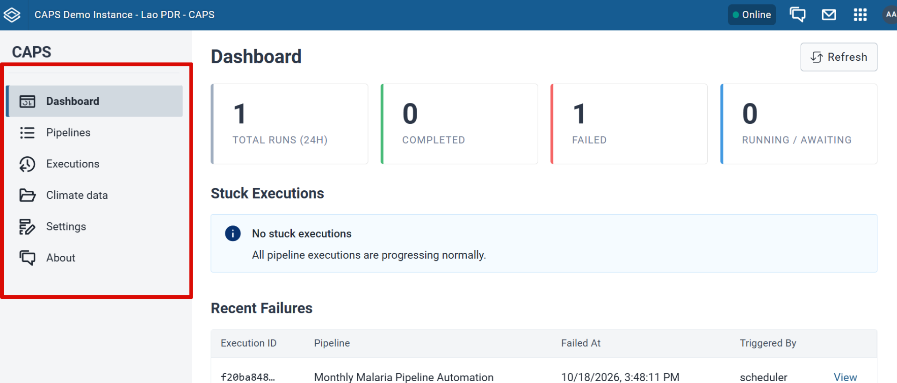

CAPS opens inside DHIS2. The left navigation is the same on every screen.

## Before you start

CAPS is installed and **Settings** shows **Connected**. That check is [Check the install](/deployment-guide/check/).

## Steps

1. Open the **App Menu**.
2. Search for **CAPS**.
3. Click **CAPS**.

The left navigation has these areas:

- **Dashboard** shows how many pipeline runs there are, how many completed or failed, and which pipelines are running or waiting. It also summarises stuck executions and recent failures.
- **Pipelines** lists the pipelines you have created. From here you create a pipeline, or run, edit, or delete one. See [Create a pipeline](/user-guide/pipelines/).
- **Executions** lists runs across every pipeline. Filter by pipeline name or by status: All, Pending, Running, Awaiting Step, Completed, Failed, Cancelled, or Paused. See [Read executions](/user-guide/executions/).
- **Climate Data** lists climate datasets imported from the Open Climate Service and is where you import another dataset. See [Import climate data](/user-guide/prepare/climate-data/).
- **Settings** and **About** are where you manage connections. **Settings** is where you connect another DHIS2 instance. **About** shows each connected instance as a card. Service URLs for CHAP, the climate service, and this DHIS2 instance are set during install, on [CHAP, climate, and DHIS2](/deployment-guide/engine/connections/).

## Check

**Dashboard**, **Pipelines**, **Executions**, **Climate Data**, **Settings**, and **About** all open from the left navigation.

## Next

[Prepare the data](/user-guide/prepare/) before you build a prediction pipeline.
