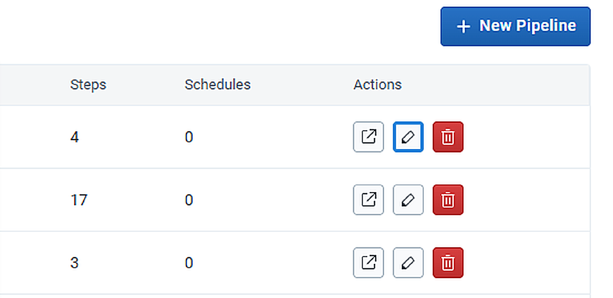
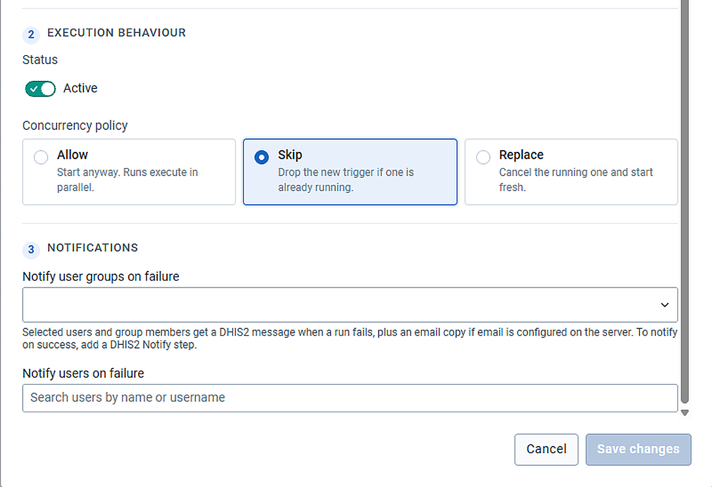
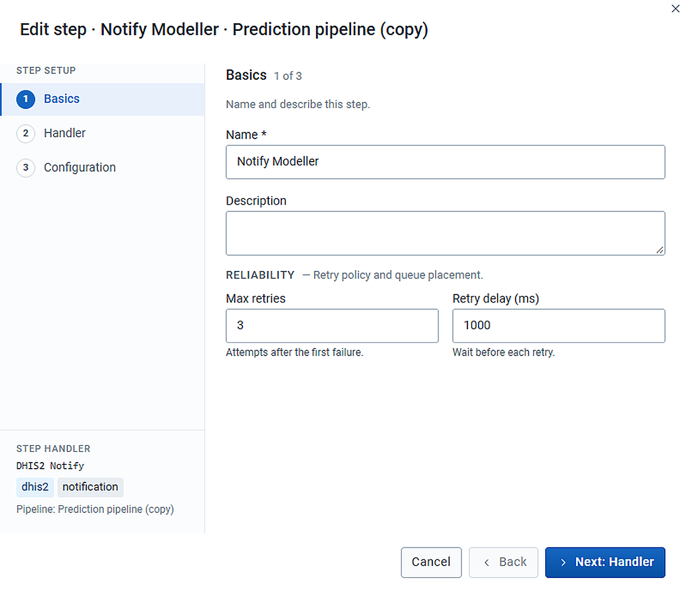
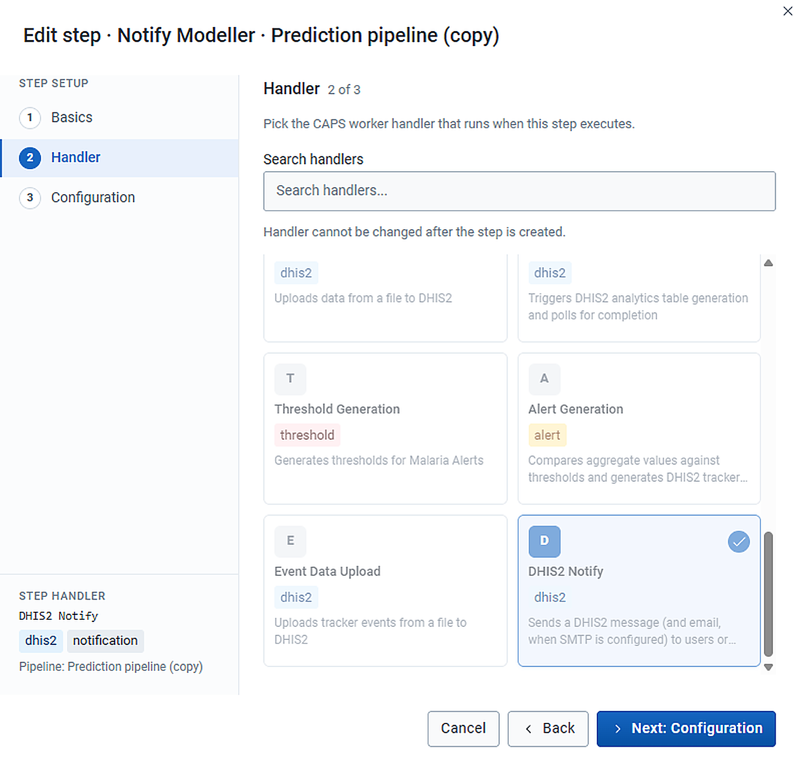
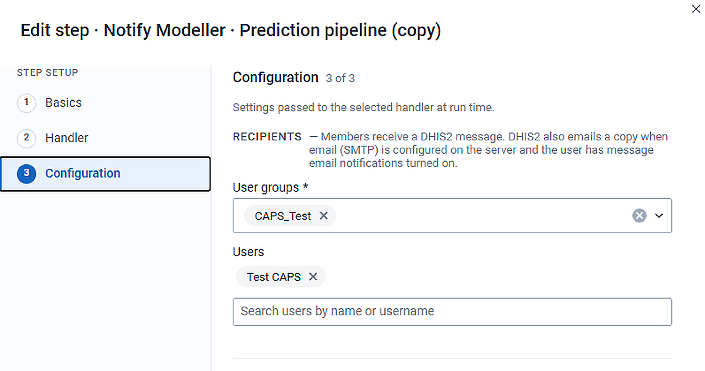
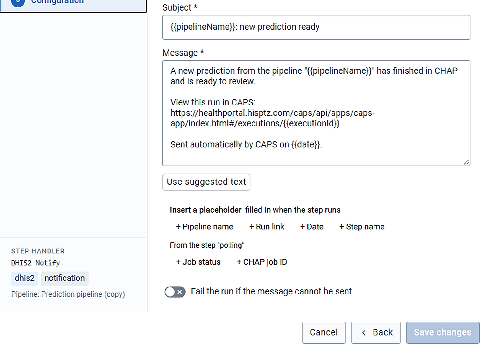

A notification is a DHIS2 message about a pipeline run. It can tell a modeller that a new prediction is ready, or tell the data team that a run has failed.

CAPS sends that message in two ways. A pipeline that runs on a [schedule](/user-guide/schedules/) normally uses both.

| | Failure notification | DHIS2 Notify step |
| --- | --- | --- |
| When the message is sent | Only when a run fails | When the run reaches the step |
| Where you set it up | **Edit pipeline**, section **3 Notifications** | On the pipeline, as a new step |
| Who writes the message | CAPS | You |
| Who receives it | The user groups and users you choose | The user groups and users you choose |

The failure notification is the message people still receive when an earlier step stops the run. The **DHIS2 Notify** step is the message for work that has finished, because that step only runs when the run reaches it.

## Before you start

- Every person who should receive a message has a user account on the DHIS2 instance where CAPS is running.
- Every person who should also receive email has a correct email address on that account.
- The user groups you will select already exist in DHIS2 and contain the right people.

## How a message arrives

CAPS sends every notification as a DHIS2 message. Open the inbox from the envelope at the top right of the DHIS2 screen. A number on the icon is how many messages are still unread.

A copy also goes by email when both of these are true:

- The DHIS2 server is set up to send email. An administrator does that in the DHIS2 system settings, with the Simple Mail Transfer Protocol (SMTP) details.
- The person has turned on email notifications for messages in their own DHIS2 account settings.

If either of those is missing, the message is still in the DHIS2 inbox.

## When a run fails

Set this once for the pipeline. After that, CAPS sends a message every time a run of that pipeline fails. The run can have been started by hand, through the API, or by a schedule. You do not write the message. CAPS writes it.

1. Open **Pipelines** and find the pipeline.
2. In **Actions**, click the pencil. That is the middle icon.

3. In **Edit pipeline**, scroll to section **3 Notifications**.

4. Choose who receives the message. You can fill in one field, or both.
   - **Notify user groups on failure.** Click the field and select a DHIS2 user group. Click the field again to add another. Every member of each selected group receives the message.
   - **Notify users on failure.** Type part of a name or username, then select the person. Repeat for each person.
5. Click **Save changes**. The button stays unavailable until you change something in the dialog.

Leave the pipeline name, description, status, and **Concurrency policy** as they are when you only want to set the recipients. Steps and schedules stay on the pipeline page. See [Trigger, edit, or delete](/user-guide/pipelines/manage/).

## When the work is done

A failure notification only covers failures. To say that a run has finished a piece of work, add a **DHIS2 Notify** step. A step named **Notify Modeller**, for example, tells the modellers that a new prediction is ready to review.

The step sends when the run reaches it. Add it from **Steps** on the pipeline, the same way as any other step. See [Create a pipeline](/user-guide/pipelines/). The dialog has three stages: **Basics**, **Handler**, and **Configuration**. **Next** moves forward. **Back** returns to the previous stage. The **Step handler** box shows the handler you chose and the pipeline the step belongs to.

### Basics

1. In **Name**, enter a name that says what the step does and who it is for, for example **Notify Modeller**. You see this name later on the execution page. A description is optional.
2. Leave **Max retries** at 3 and **Retry delay (ms)** at 1000 unless this step should try again more or less often. With 3, CAPS tries up to four times in total. The delay is in milliseconds, and 1000 milliseconds is 1 second. Those starting values cover a short busy moment on the DHIS2 server. The same fields are on [Create a pipeline](/user-guide/pipelines/).
3. Click **Next: Handler**.

### Handler

1. Type `notify` in **Search handlers**, or scroll to the card.
2. Select **DHIS2 Notify**. A tick in the corner of the card shows it is selected.
3. Click **Next: Configuration**.

The handler cannot be changed after the step is created. A wrong choice means a new step with the right handler.

### Recipients

**User groups** is required. Click the field and select at least one DHIS2 user group. Every member of the group receives the message. Click the small x beside a name to remove it.

**Users** is optional. Type part of a name or username in the search box, then select the person. Click the small x beside a name to remove that person.

One user group per team is easier to keep current. When someone joins or leaves, you change the group in DHIS2. The pipeline stays as it is.

### Message

CAPS fills in a suggested subject and message. The suggestion depends on the step immediately before this one. In the figure, that step is a poll waiting for a CHAP prediction, so the text says a new prediction is ready.

**Subject** and **Message** are both required. Keep the suggestion, or change it. **Use suggested text** puts the suggestion back.

Words inside double curly brackets are placeholders. When the step runs, CAPS replaces each one with the real value. **Insert a placeholder** adds one at the cursor.

| Button | What the person sees |
| --- | --- |
| Pipeline name | The name of the pipeline. The suggested text uses `{{pipelineName}}`. |
| Run link | A link that opens this run in CAPS. The suggested address ends with `{{executionId}}`. |
| Date | The date the message was sent. The suggested text uses `{{date}}`. |
| Step name | The name of this step |
| Job status | The result of the step before this one |
| CHAP job ID | The number CHAP gave that prediction job |

**Job status** and **CHAP job ID** appear under a line such as *From the step "polling"*. They come from the step just before this one, so a different previous step offers different buttons.

The run link is the one to keep. The person opens that run in CAPS and checks it before using the forecast. The page is [One execution](/user-guide/executions/one-run/).

With the suggested text, the message reads like this:

> **Subject:** Prediction pipeline (copy): new prediction ready
>
> A new prediction from the pipeline "Prediction pipeline (copy)" has finished in CHAP and is ready to review.
>
> View this run in CAPS: a link to the run.
>
> Sent automatically by CAPS on the date.

**Fail the run if the message cannot be sent** sits at the bottom.

- When the switch is off, the run continues if the message cannot be sent. The steps after this one still run.
- When the switch is on, the run stops at this step and shows **Failed** if the message cannot be sent.

Leave the switch off unless a team waits for the message before they start their review. A problem with messages then does not stop the rest of the work.

Click **Save changes** when you are editing a step that already exists. On a new step the button adds the step.

## Where to put the step

Steps run in order. **DHIS2 Notify** sends when the run reaches it, so put it immediately after the step whose result you want to announce.

- To say a new prediction is ready to review, put it after the step that waits for the prediction in CHAP to finish.
- To say the forecast is written to DHIS2, put it after the upload.
- To say new climate data is in DHIS2, put it after the upload step or the analytics step.

A pipeline can hold more than one **DHIS2 Notify** step, one for each message.

If a step before **DHIS2 Notify** fails, the run stops there. The notify step is never reached, so its message is not sent. The failure recipients on the pipeline are what still tell people. See [Trace a failure](/user-guide/executions/failures/).

## Check

Open the run and find the **DHIS2 Notify** step in **Step Executions**. Its status shows whether the step worked. Ask one recipient to open their DHIS2 inbox.

If the step completed and nobody received an email, the message is still in the inbox. Check the two email conditions under [How a message arrives](#how-a-message-arrives).

## Next

[Read the execution](/user-guide/executions/one-run/) to confirm the step, or [trace a failure](/user-guide/executions/failures/) when the run never reached it.
