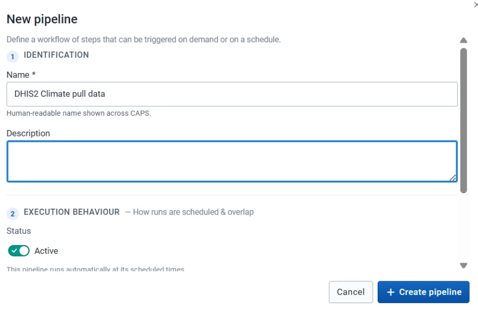
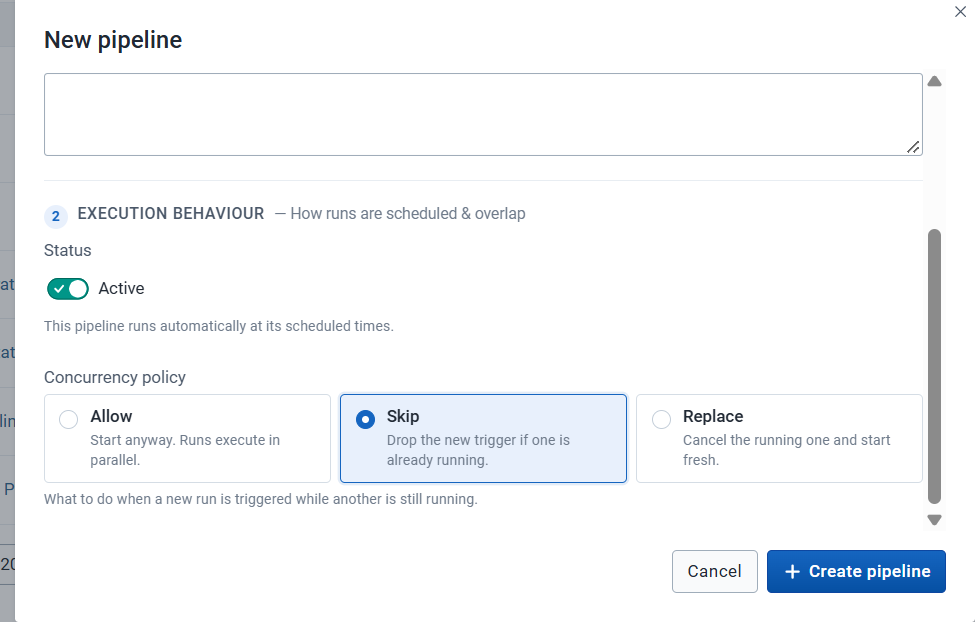
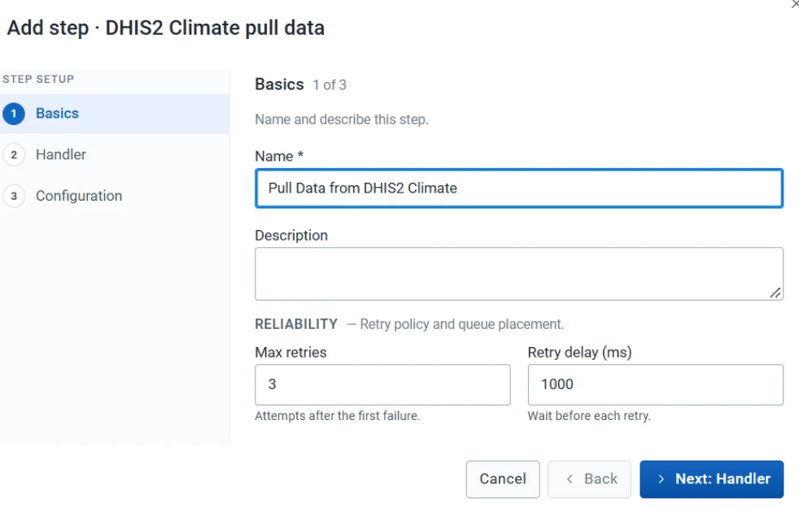

A pipeline is an ordered sequence of steps. The pipeline is the workflow. An execution is one run of it. The same pipeline can run many times, with different periods, organisation units, or other settings.

Decide the purpose before you add steps. Two common pipelines are [pulling data from another instance](/user-guide/pipelines/pull-data/) and [running a prediction](/user-guide/pipelines/prediction/). The handlers you can assign are listed on [Handlers](/user-guide/pipelines/handlers/).

## Before you start

You are on **Pipelines**. Anything the steps will read or write already exists. See [Before a pipeline](/user-guide/prepare/).

## Create the pipeline

1. Click **New Pipeline**.
2. Enter a name. A description is optional.
3. Choose the execution behaviour. This is what CAPS does when you trigger this pipeline while another run of it is still going.
4. Click **Create Pipeline**.

The new pipeline appears in the list. Open it and use **Steps** to add the workflow.

### Execution behaviour

| Behaviour | What CAPS does |
| --- | --- |
| Allow | Starts another run alongside the one already going |
| Skip | Leaves the running execution alone and does not start a new one |
| Replace | Stops the running execution and starts the new one |

Pick the behaviour that matches the workflow. Skip and Replace matter most for a scheduled pipeline, where a slow run can still be going when the next one is due.

## Add a step

Every step uses the same opening fields. The handler then asks for its own configuration.

1. Open the pipeline and go to **Steps**.
2. Click **Add step**.
3. Under **Basics**, enter a step name. A description is optional. **Max retries** and **Retry delay (ms)** start at 3 and 1000. Change them when this step should try again more or less often.
4. Under **Handler**, select the operation. See [Handlers](/user-guide/pipelines/handlers/).
5. Under **Configuration**, fill in what that handler asks for.
6. Click **Add step**.

Steps appear in the order you created them. Drag the nine-dot handle to reorder a step. Use the action buttons on a row to edit or delete that step.

### Polling and retry

Some handlers start work that finishes later, such as a climate request or a CHAP prediction. A following poll step checks that existing job.

- The **polling interval** is how long CAPS waits between checks.
- **Maximum polling attempts** is how many times it checks before it stops.

If the job never reaches the required status within those limits, the execution fails. Polling does not start the job again. The retry fields on **Basics** do that, and only after a step has failed.

## Check

The pipeline is in the list, and **Steps** shows the operations in the order they should run.

## Next

[Trigger, edit, or delete](/user-guide/pipelines/manage/) the pipeline, or [add a schedule](/user-guide/schedules/).
