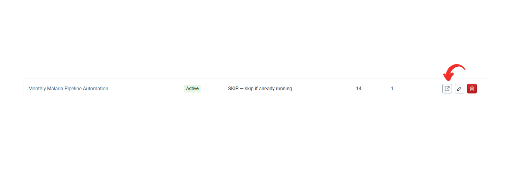
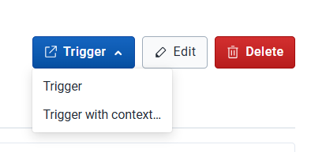
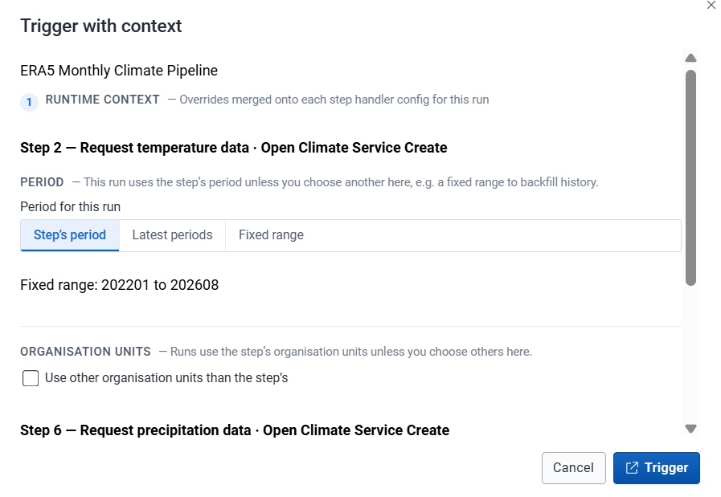
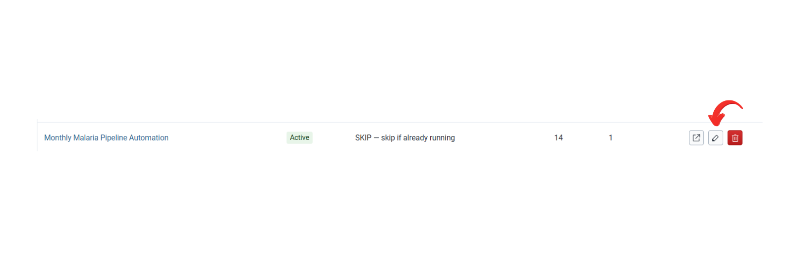
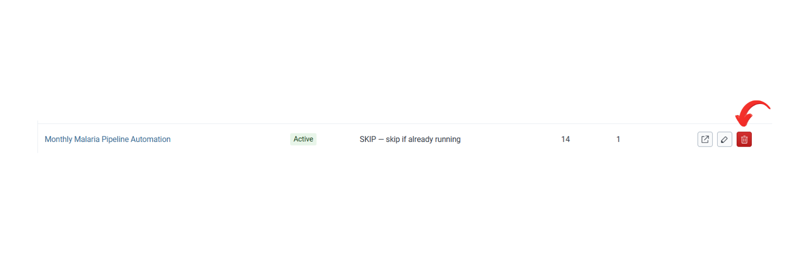
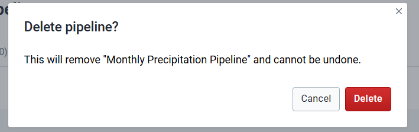

After the steps are saved, you start a run from the pipeline list or from the pipeline itself. Editing and deleting are on the same screens.

## Before you start

The pipeline has the steps it needs. See [Create a pipeline](/user-guide/pipelines/).

## Trigger

Triggering starts one execution.

**From the pipeline list.** Open **Pipelines**, find the row, and click **Trigger** in **Actions**.

**From the pipeline.** Open the pipeline and click **Trigger** at the top right. The menu beside that button has two choices:

- **Trigger** uses the period and organisation unit settings saved on the steps.
- **Trigger with context...** opens a dialog that lists those settings. Change the period or organisation units for this run, or leave them. Click **Trigger** to start. This run uses the values in the dialog. The steps keep the settings they already had.

A scheduled run can apply its own overrides. That is [Input context](/user-guide/schedules/input-context/).

## Edit

**Pipeline details.** From **Pipelines**, click **Edit** on the row. Change the fields and click **Save Changes**. Or open the pipeline, click **Edit** at the top right, and save.

**One step.** On **Steps**, click **Edit** on the row, change the step, and save it.

## Delete

**The pipeline.** From **Pipelines**, click **Delete** on the row, or open the pipeline and click **Delete** at the top right. The confirmation explains what is removed. Click **Delete** to remove the pipeline, or **Cancel** to keep it.

**One step.** On **Steps**, click **Delete** on the row. Confirm with **Delete**, or click **Cancel** to keep the step.

## Check

A triggered pipeline appears under [Executions](/user-guide/executions/) with status Pending or Running. An edit is visible when you reopen the pipeline. A deleted pipeline is gone from the list.

## Next

[Read the execution](/user-guide/executions/) to see which step the run has reached.
