This pipeline runs a monthly malaria prediction. Your model may use different covariates. Repeat the create, poll, download, and upload block once for each covariate in the prediction setup.

## Before you start

- The pipeline exists and is open on **Steps**. See [Create a pipeline](/user-guide/pipelines/).
- Climate datasets are [imported](/user-guide/prepare/climate-data/).
- An evaluation is [approved](/user-guide/prepare/modelling/) and has a prediction setup.
- Data elements exist for the covariates and the forecast quantiles. See [Data elements and datasets](/user-guide/prepare/data/).
- Case data is already on this instance, or a [pull pipeline](/user-guide/pipelines/pull-data/) has copied it here.

Shared fields on every step — name, retries, and retry delay — are on [Create a pipeline](/user-guide/pipelines/). The names below are examples.

## Steps

### 1. Sync climate datasets

This step refreshes the datasets you already imported. Name, **Max retries**, and **Retry delay (ms)** are on [Create a pipeline](/user-guide/pipelines/).

1. Click **Add step** and name it.
2. Under **Handler**, select **Open Climate Service Sync**.

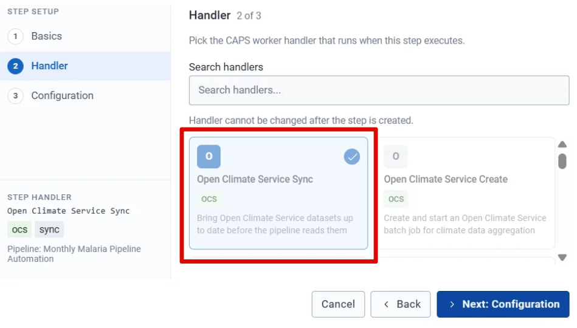

3. Under **Configuration**, select the climate datasets to synchronise.

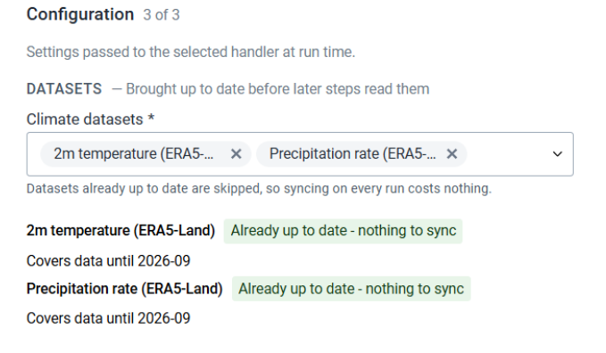

4. Choose what happens if a dataset fails to synchronise.

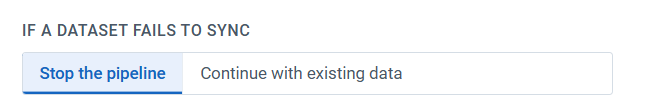

5. Under **Advanced Options**, set the period to synchronise up to. Leave it blank to use the latest available period.
6. Set the poll interval and the maximum number of attempts for queued synchronisation jobs.

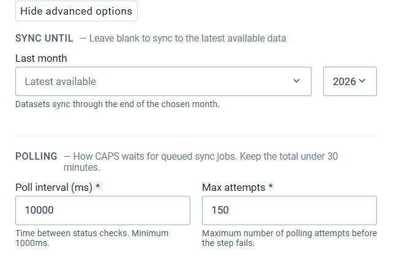

7. Click **Add step**.

### 2. Request a covariate

This step asks for one covariate, such as temperature. Repeat it later for each remaining covariate.

1. Click **Add step**. Name it, for example **Request Temperature Data**.
2. Under **Handler**, select **Open Climate Service Create**.
3. Select the climate dataset.

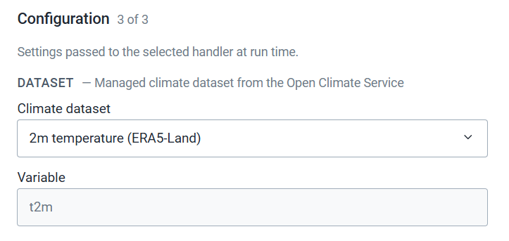

4. Select the prediction covariate, for example `mean_temperature`. The matching DHIS2 data item is filled in.
5. Select the aggregation method, for example **Average**.

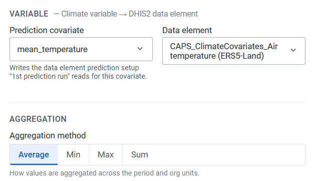

6. Select the period.
   - **Fixed Range** uses a start and an end you type.
   - **Latest Period** counts backwards from the current period. Three monthly periods in October 2026 cover July to September 2026.
   - **Skip the Most Recent Months** leaves out months that are still incomplete.

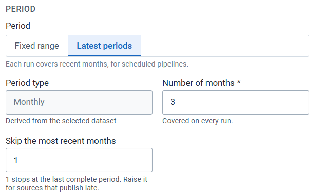

7. Select organisation units by level, or pick units from the hierarchy.

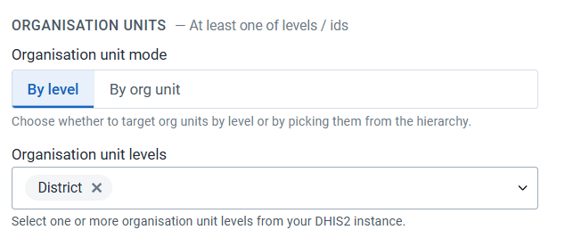

8. Click **Add step**.

### 3. Poll the covariate request

1. Click **Add step**. Name it, for example **Poll Temperature Data**.
2. Under **Handler**, select **Open Climate Service Poll**.

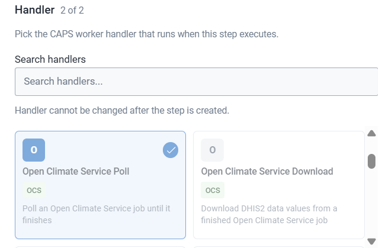

3. Click **Add step**.

The step checks the request from the previous step until that request is ready.

### 4. Download the covariate

1. Click **Add step**. Name it, for example **Download Temperature Data**.
2. Under **Handler**, select **Open Climate Service Download**.

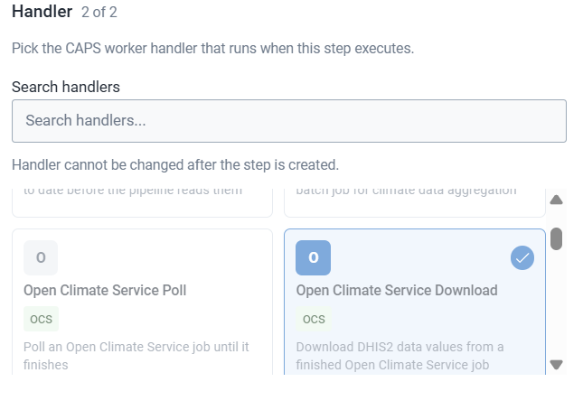

3. Click **Add step**.

The download is in a form DHIS2 can import.

### 5. Upload the covariate

1. Click **Add step**. Name it, for example **Upload Temperature Data to DHIS2**.
2. Under **Handler**, select **DHIS2 Data Upload**.

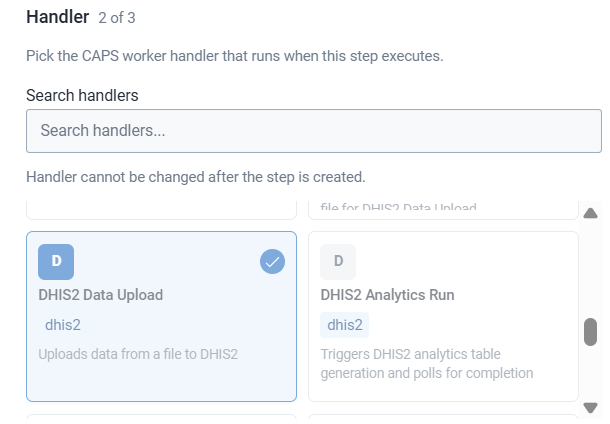

3. Select the import strategy.

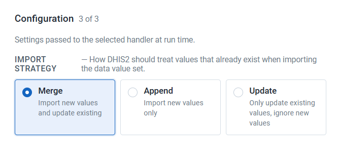

4. Click **Add step**.

### 6. Repeat for each remaining covariate

Repeat steps 2 to 5 for every other covariate in the prediction setup. This example uses temperature and precipitation, so the second pass selects the precipitation covariate and names the steps accordingly.

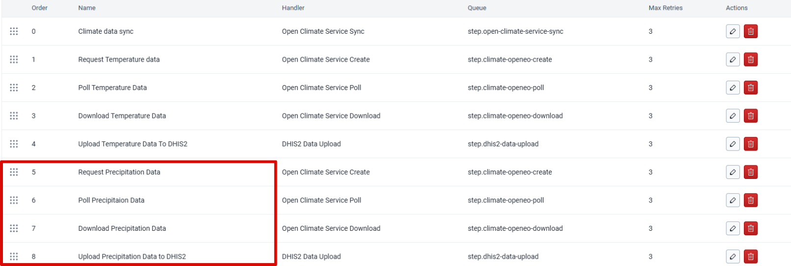

### 7. Run analytics

Analytics makes the uploaded covariates available for the prediction.

1. Click **Add step**. Name it, for example **Run Analytics**.
2. Under **Handler**, select **DHIS2 Analytics Run**.

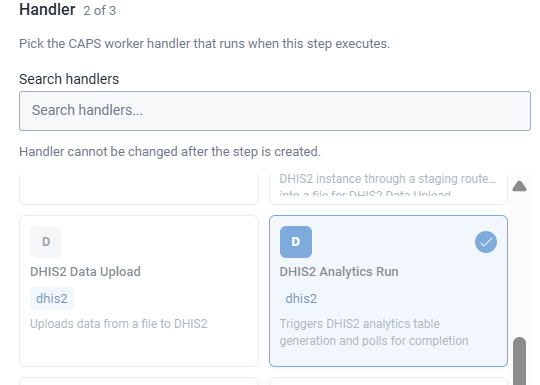

3. Set **Last years**, for example **All**, and the polling fields **Poll interval (ms)** and **Max attempts**.

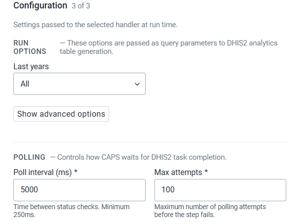

4. Click **Add step**.

### 8. Trigger the prediction

1. Click **Add step**. Name it, for example **Run CHAP Prediction**.
2. Under **Handler**, select **Prediction Trigger**.

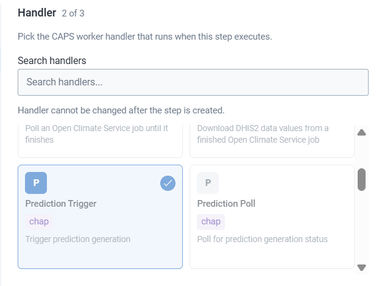

3. Select the model evaluation approved in the Modelling App. The prediction setup name is filled in.
4. Enter a job name. CHAP uses this name for the prediction job.

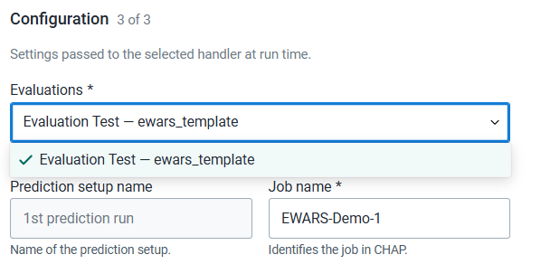

5. Select the training period and the number of periods to forecast.

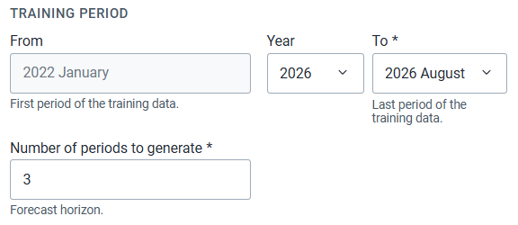

6. Select organisation units by level, or pick them from the hierarchy.

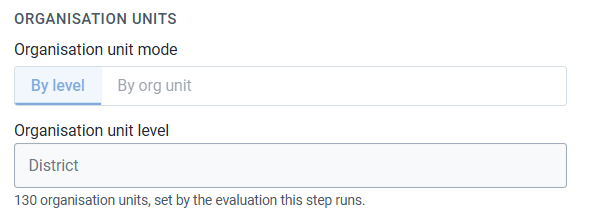

7. Review the covariates and the DHIS2 data items shown in the configuration.

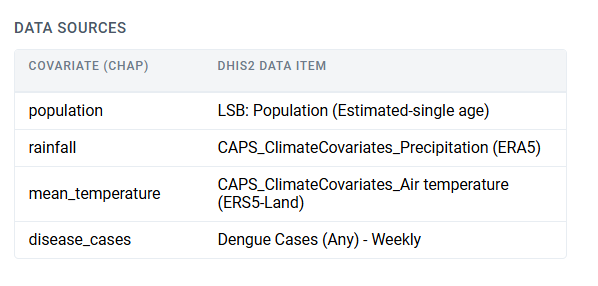

8. Click **Add step**.

### 9. Poll the prediction

1. Click **Add step**. Name it, for example **Poll CHAP Prediction**.
2. Under **Handler**, select **Prediction Poll**.

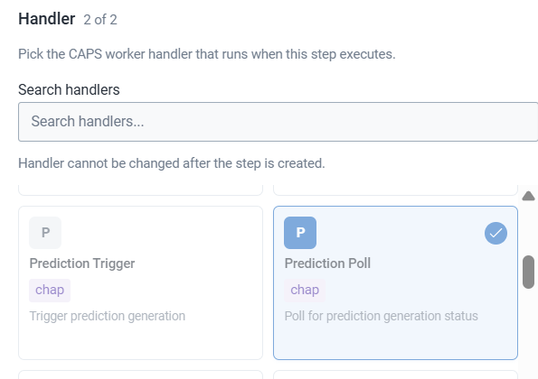

3. Click **Add step**.

### 10. Download the forecast

1. Click **Add step**. Name it, for example **Download CHAP Prediction**.
2. Under **Handler**, select **Prediction Data Download**.

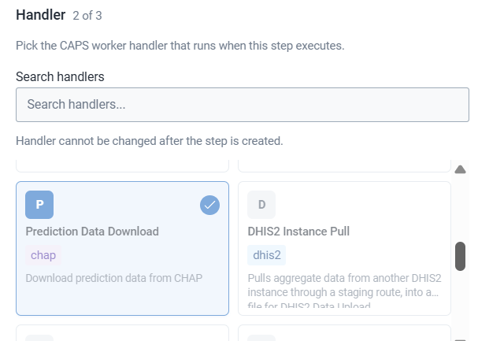

3. Review the forecast outputs and where they will be written.

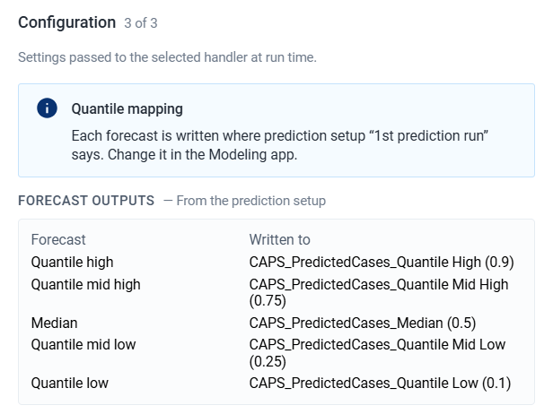

4. Click **Add step**.

### 11. Upload the forecast

1. Click **Add step**. Name it, for example **Upload Prediction to DHIS2**.
2. Under **Handler**, select **DHIS2 Data Upload**.
3. Select the import strategy for the prediction results. The control is the same import strategy as the covariate upload above.
4. Click **Add step**.

Drag the nine-dot handle if a step is out of order. For two covariates the order is: sync, then temperature create-poll-download-upload, then precipitation create-poll-download-upload, then analytics, trigger, poll, download, and upload.

## Check

**Steps** lists every covariate block, then analytics, then the four prediction steps. After you [trigger](/user-guide/pipelines/manage/) the pipeline, the forecast values appear in the [sectioned dataset](/user-guide/prepare/data/) in Data Entry.

## Next

[Schedule the pipeline](/user-guide/schedules/) so each run moves forward to the latest periods.
