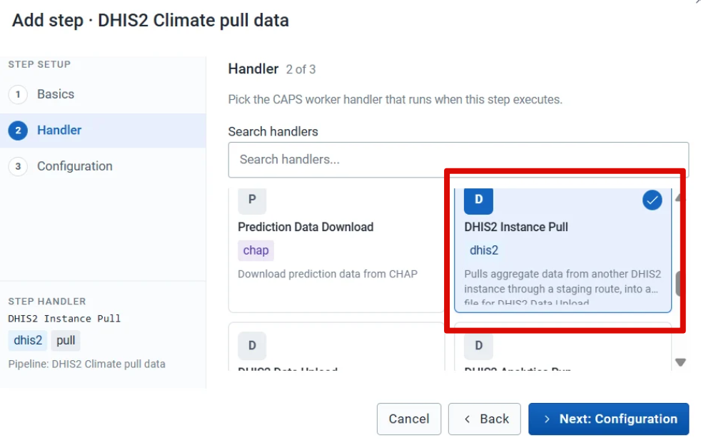
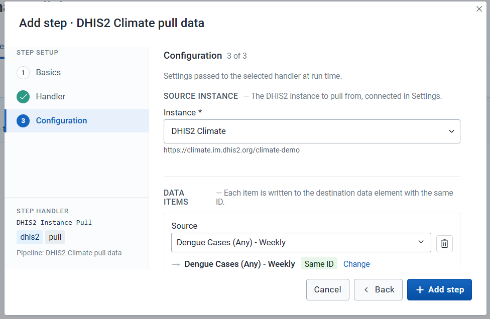
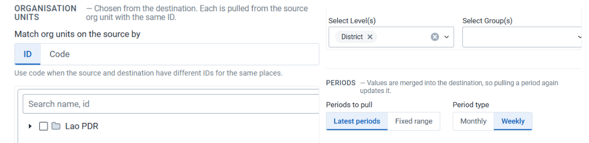
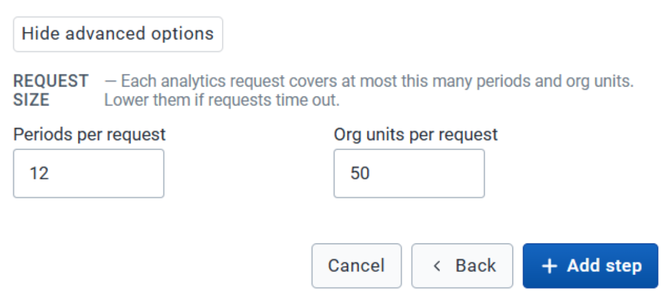
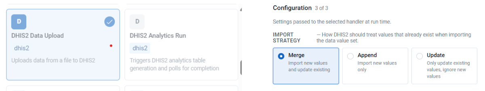
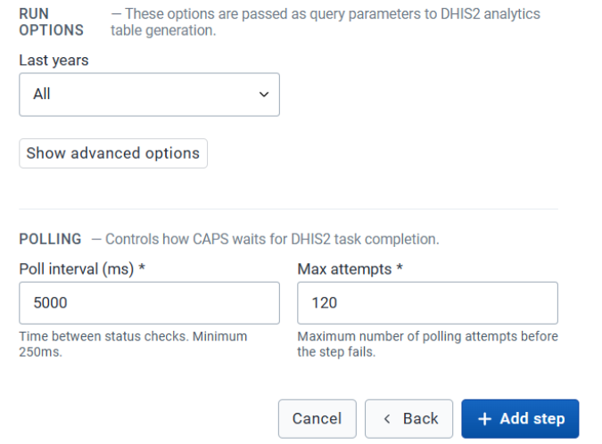

Use this pipeline when case data lives on another DHIS2 instance. Three steps copy the values you select onto this instance and make them available in analytics.

## Before you start

- The pipeline exists and is open on **Steps**. See [Create a pipeline](/user-guide/pipelines/).
- The source instance is connected. See [Connect a source instance](/user-guide/prepare/connections/).
- This instance has data elements to store the pulled values. See [Data elements and datasets](/user-guide/prepare/data/).

Shared fields on every step — name, retries, and retry delay — are on [Create a pipeline](/user-guide/pipelines/).

## Steps

### 1. Pull from the source instance

1. Click **Add step**.
2. Under **Basics**, name the step. The name, **Max retries**, and **Retry delay (ms)** fields are the same on every step. See [Create a pipeline](/user-guide/pipelines/).
3. Under **Handler**, select **DHIS2 Instance Pull**.

4. Under **Configuration**, select the source instance.
5. Select the data items to pull. You can choose data elements, program indicators, or indicators. Click **Add Item** for another item.

6. Choose whether to map organisation units by ID or by code, and select the organisation unit level.
7. Select the periods and the period type.

8. Under **Advanced Options**, set how many periods and organisation units to request at a time.

9. Click **Add step**.

### 2. Upload to this instance

1. Click **Add step**.
2. Name the step.
3. Under **Handler**, select **DHIS2 Data Upload**.
4. Under **Configuration**, select the import strategy.

5. Click **Add step**.

### 3. Run analytics

1. Click **Add step**.
2. Name the step.
3. Under **Handler**, select **DHIS2 Analytics Run**.
4. Under **Configuration**, set **Last years** (for example **All**) and the polling fields **Poll interval (ms)** and **Max attempts**.

5. Click **Add step**.

The three steps are listed in that order. Drag a row to change the order.

## Check

**Steps** shows the pull, the upload, and the analytics run, in that order. A later [trigger](/user-guide/pipelines/manage/) writes the selected values onto this instance.

## Next

[Run a prediction](/user-guide/pipelines/prediction/) once the health data and climate covariates are on this instance.
