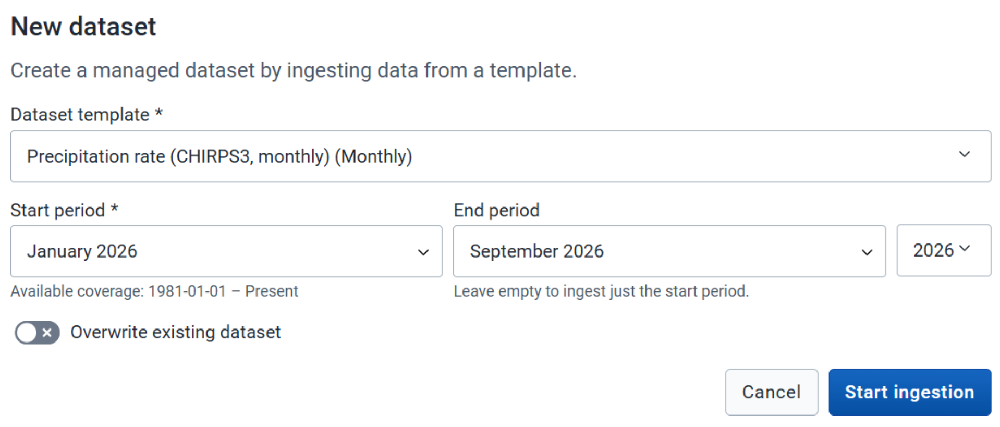
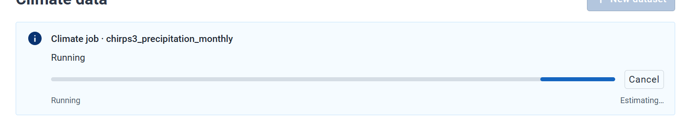
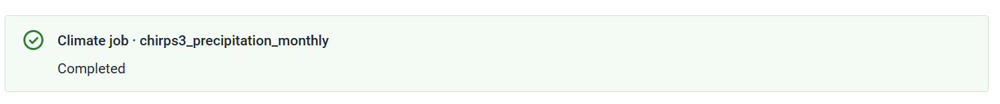

CAPS imports climate data from the Open Climate Service. CHAP uses that data when it models. Import a dataset here once. A prediction pipeline can then keep it current with an **Open Climate Service Sync** step.

## Before you start

The climate service URL is reachable from the CAPS workers. That URL is set at install, on [CHAP, climate, and DHIS2](/deployment-guide/engine/connections/). You are on the [Climate Data](/user-guide/interface/) screen.

## Steps

1. Click **Climate Data** in the left navigation.
2. Click **+ New Dataset**.
3. Open the dataset template list and select the template you need. For example, **Precipitation rate (CHIRPS3, monthly) (Monthly)**.

4. Select the period to import. For example, January 2026 to September 2026. If this dataset already exists in CAPS, turn on **Overwrite Existing Dataset** to replace it.
5. Click **Start Ingestion**.

When it finishes, a success message appears and the dataset is in the list.

## Check

The dataset you selected is listed under **Climate Data**, for the period you chose.

## Next

If case data lives on another DHIS2 instance, [connect that instance](/user-guide/prepare/connections/). Otherwise [create a pipeline](/user-guide/pipelines/).
