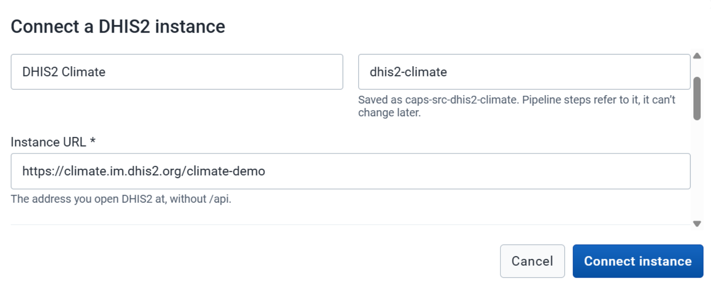
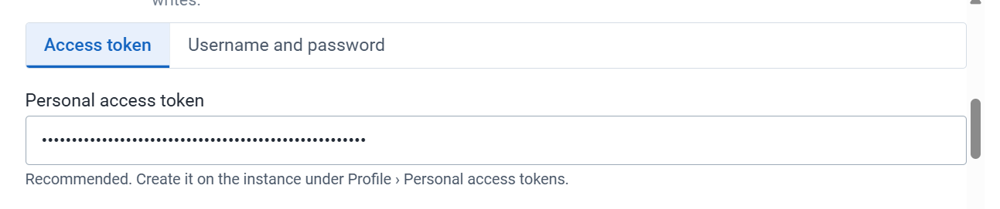
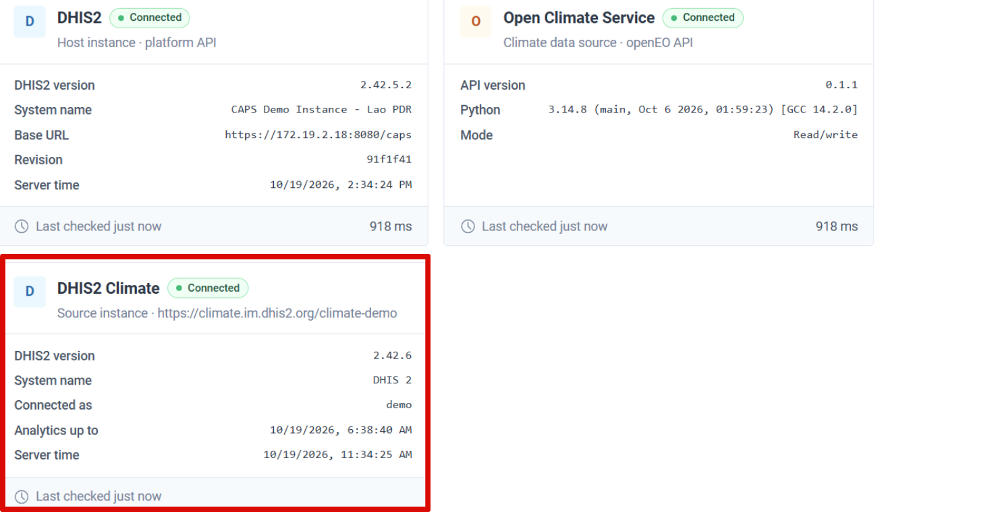
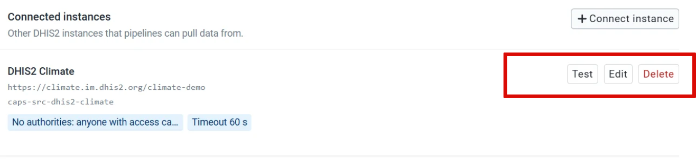

When the data for a forecast is stored on another DHIS2 instance, connect that instance and pull the data into this one. CHAP then uses the copy on this instance.

## Before you start

- The source instance uses the same organisation unit hierarchy as this staging instance.
- This instance already has the [data elements](/user-guide/prepare/data/) that will store the values you pull.
- You can sign in to the source instance. A personal access token, created from the profile menu on the source instance, is the method to use. A username and password also work.
- Worker URLs for this DHIS2 instance are already set. That is [CHAP, climate, and DHIS2](/deployment-guide/engine/connections/). Connecting a *source* instance is the task on this page.

## Steps

1. Open **Settings**.
2. Click **Connect Instance**.
3. Fill in the source instance details.

4. Choose the authentication method. **Personal Access Token** is the method to use. Otherwise enter the username and password for the source instance.

5. Click **Connect Instance**.
6. Open **About**. The instance appears as a card with its name, connection status, and other details.

To change the connection, return to **Settings**. From the instance you can edit its details, test the connection, or delete it.

## Check

**About** shows the source instance, and a connection test from **Settings** succeeds.

## Next

A [pull pipeline](/user-guide/pipelines/pull-data/) copies the data you need onto this instance.
