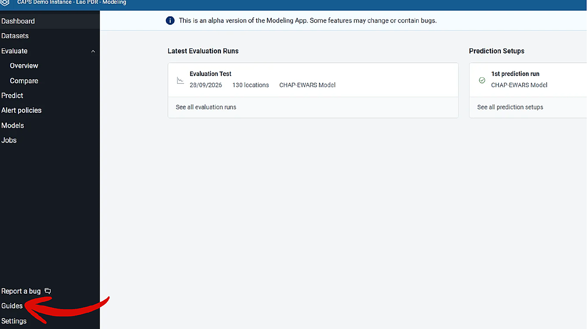
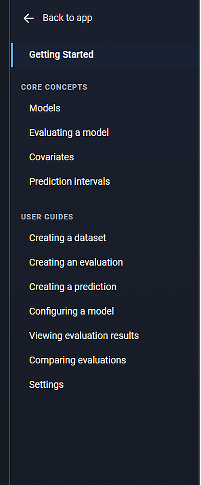
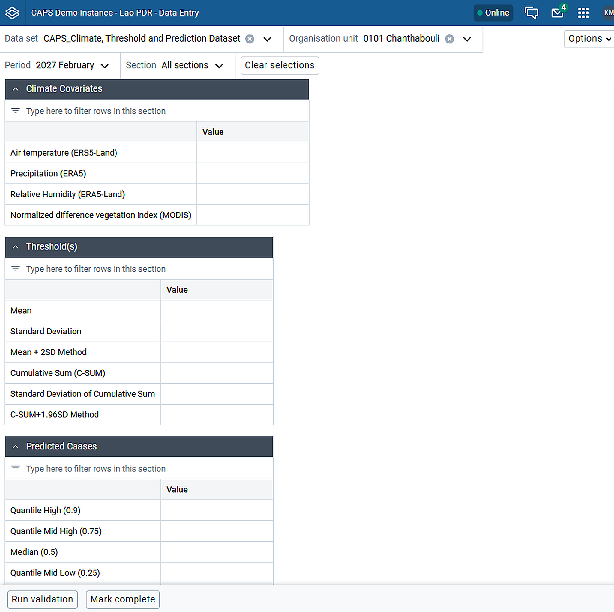

DHIS2 needs a place to store the values a prediction reads and writes. Create the data elements first, then two datasets that use them.

## Before you start

You can create data elements and datasets in this DHIS2 instance. The names below are an example for a monthly malaria prediction. Use names that identify the category and the value, so related elements group together when you select them in a pipeline step.

## Data elements

Create a data element for each of these kinds of value:

- **Climate covariates**, the values from the Open Climate Service that the model uses as inputs, such as air temperature and rainfall.
- **Thresholds**, the values against which predicted and reported cases are judged.
- **Prediction results**, the forecast values the model produces, one for each quantile.

| Category | Data element | What it holds |
| --- | --- | --- |
| Climate covariates | `CAPS_ClimateCovariates_Air temperature (ERA5)` | Temperature |
| Climate covariates | `CAPS_ClimateCovariates_Precipitation (ERA5)` | Rainfall |
| Thresholds | `CAPS_Threshold_Mean` | Mean |
| Thresholds | `CAPS_Threshold_Standard Deviation` | Standard deviation |
| Thresholds | `CAPS_Threshold_Mean + 2SD Method` | Mean + 2SD method |
| Thresholds | `CAPS_Threshold_Standard Deviation of Cumulative Sum` | Standard deviation of cumulative sum |
| Thresholds | `CAPS_Threshold_Cumulative Sum (C-SUM)` | Cumulative sum (C-SUM) |
| Thresholds | `CAPS_Threshold_C-SUM+1.96SD Method` | C-SUM + 1.96SD method |
| Predictions | `CAPS_PredictedCases_Quantile High (0.9)` | High quantile (0.9) |
| Predictions | `CAPS_PredictedCases_Quantile Mid High (0.75)` | Mid-high quantile (0.75) |
| Predictions | `CAPS_PredictedCases_Median (0.5)` | Median (0.5) |
| Predictions | `CAPS_PredictedCases_Quantile Mid Low (0.25)` | Mid-low quantile (0.25) |
| Predictions | `CAPS_PredictedCases_Quantile Low (0.1)` | Low quantile (0.1) |

## The modelling dataset

After the data elements exist, create a dataset in the Modelling App. This is the dataset the model works against during evaluation and prediction.

1. Open the Modelling App in DHIS2.
2. In the left navigation, click **Guides** at the bottom.
3. Under **User Guides**, select **Creating a dataset** and follow that guide.

## The sectioned dataset

Create a second dataset in the Maintenance app, with sections. It is a view over the same data elements, arranged into sections for the climate covariates, the threshold values, and the prediction results.

1. Assign the dataset to the organisation units the forecast covers.
2. Give it the same period type as the prediction.
3. After a pipeline has written values, open the dataset in the Data Entry app for an organisation unit and a period.

Each section is one block, with one row per data element. Climate covariate rows hold values imported from the Open Climate Service. Threshold and prediction rows hold values the pipeline generated.

## Check

The modelling dataset exists in the Modelling App, and the sectioned dataset opens in Data Entry for the organisation units and period type you will forecast.

## Next

Create an approved [evaluation and prediction setup](/user-guide/prepare/modelling/) against the modelling dataset.
