A schedule runs a pipeline at defined times. A pipeline can hold more than one schedule, and each schedule is managed on its own. Overrides for period, organisation units, and training live on [Input context](/user-guide/schedules/input-context/).

## Before you start

The pipeline and its steps are saved. See [Create a pipeline](/user-guide/pipelines/).

## View schedules

Open the pipeline and select **Schedules**.

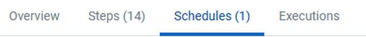

The number in brackets is how many schedules this pipeline has. **Steps** uses the same convention, so **Steps (14)** and **Schedules (1)** means fourteen steps and one schedule.

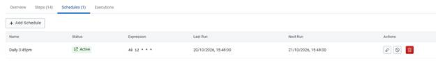

A pipeline with no schedules shows the tab without a number.

| Column | What it shows |
| --- | --- |
| Name | The name you gave the schedule. It is the only text you write, so make the timing obvious. |
| Status | **Active** will fire. **Disabled** keeps every setting and fires nothing. |
| Expression | The cron expression. Five values separated by spaces. |
| Last Run | When the schedule last fired. Blank until the first run. |
| Next Run | When it is due next. Calculated from the expression. A disabled schedule has none. |
| Actions | Edit, disable, or delete. |

Read **Last Run** and **Next Run** together. A schedule meant to run monthly, with those two dates a day apart, has the wrong expression.

## Add a schedule

On **Schedules**, click **Add Schedule**.

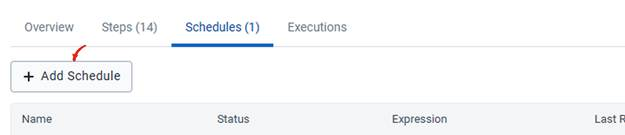

The dialog is titled **Add schedule** and shows the pipeline name. Work through the sections in order.

| Section | What it settles |
| --- | --- |
| 1 Identification | What this schedule is called |
| 2 Trigger | When it fires |
| 3 Input context | What each step uses on this schedule |

Identification and Trigger are required. Leave Input context alone and every step uses the settings saved on the step. See [Input context](/user-guide/schedules/input-context/).

### Identification

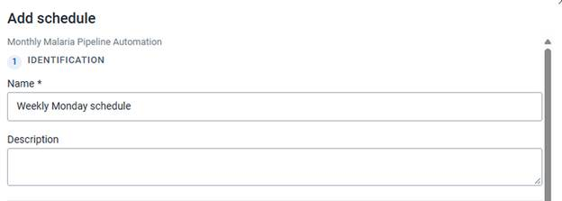

**Name** is required. It is the label in the Schedules table, and it is how you tell one schedule from another. *Weekly Monday schedule* and *Daily 3:45pm* still make sense when a second schedule exists.

**Description** is optional. Use it when the reason for the time would not be obvious, for example a run timed to follow a national reporting deadline. The description is not shown in the table. It is there for the next person who opens the schedule.

### Trigger

A cron expression is five values separated by spaces: minute, hour, day of the month, month, and day of the week. Together they say at which minutes of which hours, on which days, this run happens.

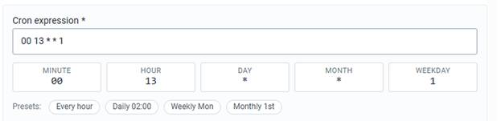

Five read-only boxes under the field show how CAPS parsed the expression. Edit the **Cron expression** field, or click a preset. The boxes update either way.

| Position | Box | Accepts | Meaning |
| --- | --- | --- | --- |
| 1st | MINUTE | 0 to 59 | The minute within the hour |
| 2nd | HOUR | 0 to 23 | The hour, on a 24-hour clock |
| 3rd | DAY | 1 to 31 | The day of the month |
| 4th | MONTH | 1 to 12 | The month of the year |
| 5th | WEEKDAY | 0 to 6 | The day of the week, Sunday to Saturday |

An asterisk (`*`) means every value of that unit.

`0 13 * * 1` is minute 0, hour 13, every day of the month, every month, weekday 1. Weekday 1 is Monday, so the schedule fires at 13:00 every Monday. `0 13 * * *` fires at 13:00 every day. `0 13 1 * 1` fires only when the first of the month is a Monday. Restricting DAY and WEEKDAY together is rarely what you want.

#### Presets

Click a preset to rewrite the expression. The selected preset is outlined.

- **Every hour** writes `0 * * * *`. The pipeline runs at the top of every hour.

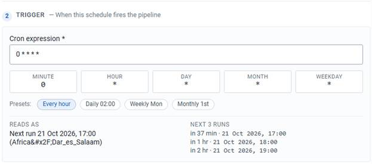

- **Daily 02:00** writes `0 2 * * *`. The next runs fall on consecutive dates at 02:00.

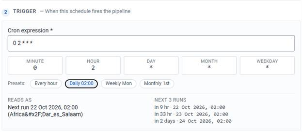

- **Weekly Mon** sets weekday 1. The next runs are seven days apart.

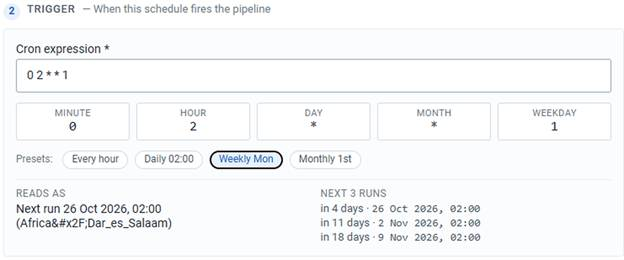

- **Monthly 1st** sets the day of the month to 1 and clears the weekday. The next runs fall on the first of consecutive months.

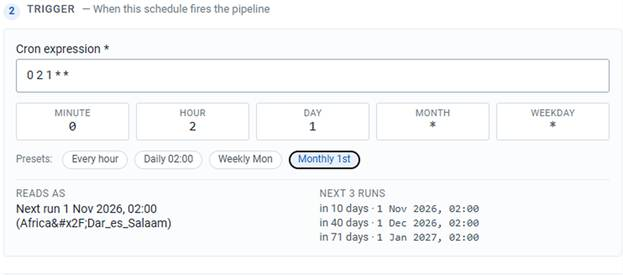

**Weekly Mon** and **Monthly 1st** name a day and keep the hour already in the expression. After either preset, check the HOUR box and edit the expression if that hour is wrong.

A preset is a starting point. **Weekly Mon** followed by changing the hour to 13 gives `0 13 * * 1`, which is 13:00 every Monday.

#### Confirm the time

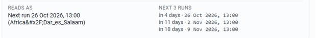

Two panels under the expression translate it back.

- **Reads As** states the next run in plain language, with the time zone in brackets beneath.
- **Next 3 Runs** lists the next three firing times and how far away each one is. The spacing is the check: three dates seven days apart is weekly, and three dates one day apart is daily.

Read both before you save. An expression can be valid and still fire at the wrong time.

## Save

**Add schedule** creates the schedule. The dialog title stays **Add schedule**.

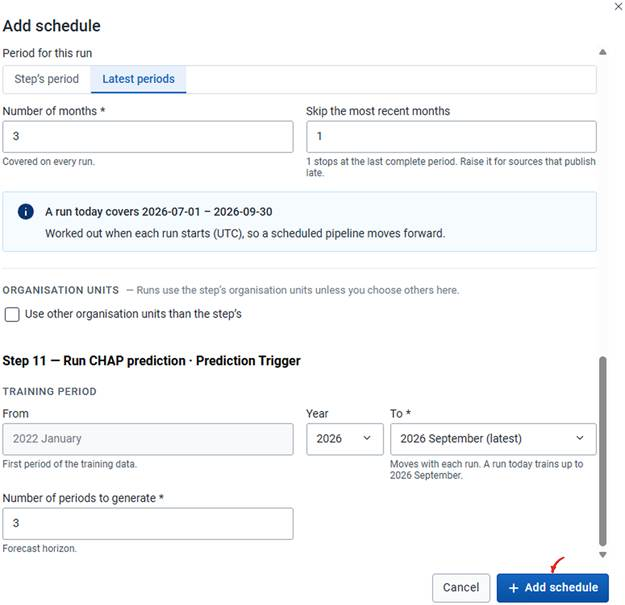

An existing schedule opens the same dialog titled **Edit schedule**. The button is **Save changes**.

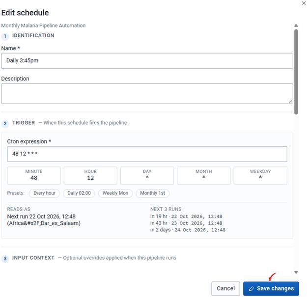

**Cancel** closes the dialog and discards what you typed.

A saved schedule appears in the table at once. **Next Run** is already filled. **Last Run** stays empty until the schedule fires.

## Edit, disable, or delete

The icons on a row are edit, disable, and delete. Delete is the red control.

**Edit.** Click the pencil.

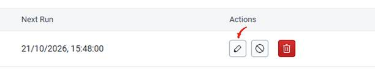

The same dialog opens, titled **Edit schedule**, with the current values. Click **Save changes**. The edit applies from the next firing. A run already in progress keeps the settings it started with.

**Disable.** Click the circle with a line through it.

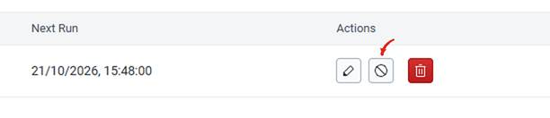

The schedule stops firing and keeps every setting. Status becomes disabled and **Next Run** clears. The same control enables it again. Use this during maintenance, a data freeze, or any period when an automatic run would write incomplete results. Disable when you expect to want the schedule again. The cron expression and the input context stay intact.

**Delete.** Click the red bin.

The schedule is removed. The pipeline and its steps stay, and you can still trigger the pipeline by hand or with another schedule. Deleting also discards the input context overrides.

## When you set the time

- Confirm the expression, the time zone, and the next runs before you save.
- Schedule the run for when the health data and the climate data should already be available.
- Use latest-period settings when each run should move forward. See [Input context](/user-guide/schedules/input-context/).
- For a recurring prediction, decide whether the training end period should advance as new data arrives.
- Check that each run targets the organisation units you intend.
- Leave the schedule active when you want it to fire.
- Watch **Last Run** and **Next Run** for a pattern you did not intend.

## Check

**Schedules** shows the new row as active, **Reads As** matches the time you wanted, and **Next 3 Runs** are spaced the way you intended.

## Next

Set [input context](/user-guide/schedules/input-context/) when this schedule should use different periods or organisation units than the steps.
