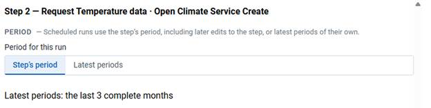
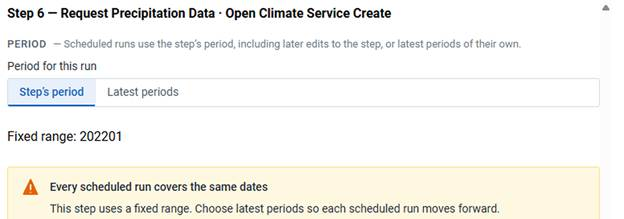
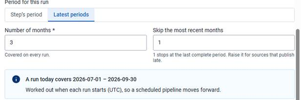
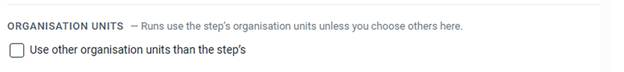
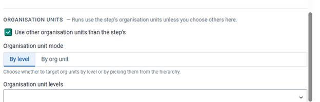
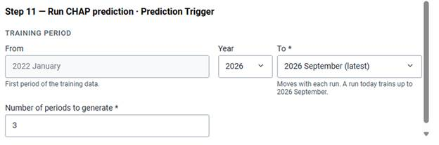

Input context is the optional third section of **Add schedule** and **Edit schedule**. It lists only the steps that accept a period or an organisation unit, each with its number, name, and handler. For example, *Step 2 — Request Temperature data · Open Climate Service Create*.

Every setting here already exists on the step. An override lets this schedule use different values. The step itself stays as it was, so one pipeline can carry a monthly schedule and a backfill schedule that cover different periods. Leaving the section untouched is valid.

## Before you start

You are in the schedule dialog from [Schedule a pipeline](/user-guide/schedules/).

## Period

Each listed step has **Period for this run**. One tab is selected, and that tab is what the step covers on every run of this schedule.

### Step's period

**Step's period** adds nothing. The step's own setting applies. A line under the tabs reports what that setting is.

- *Latest periods: the last 3 complete months* means the step already holds a rolling window. Each run moves forward on its own.
- *Fixed range: 202201* means the step is pinned to dates that were chosen once. CAPS warns: *Every scheduled run covers the same dates. This step uses a fixed range. Choose latest periods so each scheduled run moves forward.*

A fixed range does not fail. The pipeline runs, every step reports success, and the same months are fetched and written again on every firing. The execution list does not mark that as a problem. Switch this step to **Latest periods** here, or change the step itself.

### Latest periods

**Latest periods** replaces the step's period with a rolling window calculated when each run starts.

| Field | What it controls | How to choose |
| --- | --- | --- |
| Number of months | How many periods each run covers | Match what the model or the report needs. Three is common for a monthly prediction. |
| Skip the most recent months | How many recent periods to leave out | 1 stops at the last complete period. Raise it when the source publishes late. |

The current period is always incomplete. Counting back from today would pull a part-month and treat it as whole. Skipping one period moves the window back to the last period that finished.

An information panel states the window a run starting today would cover. The window is calculated when each run starts, in UTC, which is what makes the pipeline move forward on its own.

## Organisation units

Under the period settings, each step offers an organisation unit override: *Runs use the step's organisation units unless you choose others here.*

Left unticked, the step uses the organisation units it already holds. The block stays collapsed.

Tick **Use other organisation units than the step's** to reveal the mode. Only one mode applies.

| Mode | What it targets | When it suits |
| --- | --- | --- |
| By level | Every organisation unit at a chosen level | A national run, for example every district. Units added later at that level are included without editing the schedule. |
| By org unit | Specific organisation units from the hierarchy | A pilot or a subset that should stay a fixed list. |

**By level** is selected by default. **Organisation unit levels** lists the levels in this DHIS2 instance, and you can choose more than one. **By org unit** replaces that list with the organisation unit tree.

The level selector opens empty. An override that is ticked with nothing selected has nothing to run against. Make the selection before you save.

Use an organisation unit override when this schedule should cover a different scope from the step. One schedule can run nationally each month while another runs over a pilot region each week.

## Training period

A **Prediction Trigger** step shows a training period instead of a data period. The training period is the span of past data the model learns from. It is separate from the span of data the pipeline fetches.

| Field | What it controls | Notes |
| --- | --- | --- |
| From | The first period of the training data | Fixed and read-only. It comes from the prediction setup in CHAP. |
| Year and To | The last period of the training data | Choosing **latest** moves the end forward with each run. The field states which period a run today would train up to. |
| Number of periods to generate | How many periods ahead the model predicts | 3 on a monthly pipeline produces a three-month forecast. |

**Latest** keeps a recurring prediction current. A fixed end date leaves the model training on the same window while the forecast period moves away from it. The forecast is then made from older and older data. That is the same staleness as a fixed data range.

## Check

For a recurring schedule, each step that should move forward shows **Latest periods**, the organisation unit selection is filled in if you ticked an override, and a prediction step uses **latest** as the training end.

## Next

Save the schedule from [Schedule a pipeline](/user-guide/schedules/), then [read an execution](/user-guide/executions/) after the first firing.
